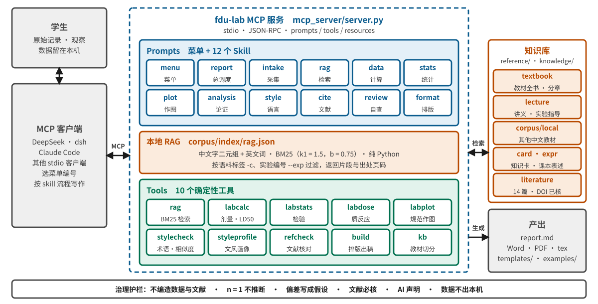
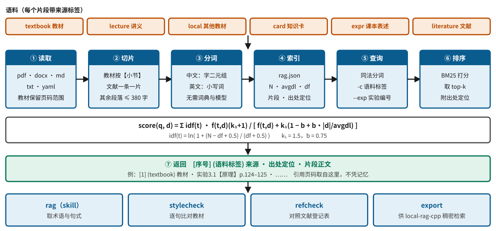

<div align="center">

# FDU Func Lab Helper

### 复旦《功能学科综合实验》实验报告写作助手 · RAG + Skill + 可核对的工具

*模型可以组织语言，但数字、检验和引用必须由工具给出，并能回到出处。*

**刘瑞琦 (Rachael Liu)**<sup>1</sup>　·　<a href="mailto:24301050114@m.fudan.edu.cn">24301050114@m.fudan.edu.cn</a>

<sup>1</sup> 复旦大学上海医学院，24 级临床医学五年制

[使用指南](docs/GUIDE.md) · [设计说明](DESIGN.md) · [RAG](#rag-是怎么工作的) · [参考资料库](reference/README.md) · [格式规范](docs/FORMAT.md) · [**模板**](#模板) · [English](README.en.md)

[](LICENSE)
[](requirements.txt)
[](.agents/skills)
[](tools)
[](tests)
[](reference/literature/README.md)
[](knowledge)

<a href="assets/readme/architecture.svg"></a>

</div>

## 摘要

功能学实验报告常见三类问题：**用语偏离教材**、**数据与统计处理不规范**、**参考文献无法核实**。本项目把它们分别交给三层结构：
**知识层**（RAG）以教材、讲义、课本表述整理和重点文献为语料，让措辞贴近课本并可回到页码；
**工具层**用确定性代码完成计算、统计、作图、语言检查、文献核对和排版；
**Skill 层**把这些步骤编排成一条流水线，由总菜单分发，AI 担任写作教练而非代笔。
全程无服务器，在学生自己的 DeepSeek 环境（网页或 dsh）中使用；数据留在本机。
**原始数据与观察必须来自学生本人的实验；本项目不用于规避 AI 检测，AI 使用情况应按课程要求声明。**

## 它是什么，不是什么

| 层 | 它做的 | 它**拒绝**做的 |
|---|---|---|
| 知识层 RAG | 检索课本、讲义、课本表述、重点文献，返回片段+页码 | 不凭记忆引用页码；找不到依据不补全 |
| 工具层 | 计算、统计、作图、相似度、文献核对、排版，全部可复现 | 不让模型心算；n=1 不检验；不把“文献存在”说成“论点成立” |
| Skill 层 | 采集→检索→计算→统计→作图→论证→写作→语言→文献→自查→出稿 | 不代写观察；不编造数据；不以规避检测为目的 |
| 模板 | Word / LaTeX 通用模板：写作内容、格式要求、字体、单一极简封面 | 不堆砌装饰；封面不抢正文 |

## 亮点

| # | 设计 | 防止了什么 |
|---|---|---|
| 1 | **课本对齐检索**：教材全书 + 7 个实验的术语/句式整理 + 本地补充教材，BM25 无服务器 | 通用“医学腔”、术语不一致 |
| 2 | **语言检查** `stylecheck`：术语覆盖、模板腔、逐句与课本相似度（≥0.60 过近，<0.15 缺依据） | 抄课本、AI 套话、无依据的机制句 |
| 3 | **文献核对** `refcheck`：DOI/题名/第一作者/年份/卷页逐项对 Crossref；14 篇重点文献预先核对 | 编造文献、张冠李戴、页码年份写错 |
| 4 | **统计与作图规范** `labstats` / `labplot`：方法选择建议、误差线与 n 写进图注、色盲友好 | 小样本滥用检验、图表不规范 |
| 5 | **总菜单提示词** `prompts/menu.md`：12 项功能 + 成本分级（L0 工具 / L1 检索 / L2 起草） | 不知从何开始、整篇让模型重写的浪费 |
| 6 | **分析协议**：观察→预期→机制→偏差作假设→局限→临床联系 | 把偏差硬凑成“符合理论” |
| 7 | **真实改编示例**：作者本人作业（隐去身份信息，保留 12 张原始记录图） | 示例不真实、不知道写到什么程度 |

## 快速开始

需要 Python ≥ 3.10、pandoc；出 PDF 另需 XeLaTeX（含 ctex）。

```bash
git clone https://github.com/rachael1216/fdu-func-lab-helper.git
cd fdu-func-lab-helper
pip install -r requirements.txt
python tools/build.py --doctor                                     # 检查环境
python tools/rag.py build                                          # 建检索索引（课本已在 reference/textbook/）
python tools/build.py examples/sample-report/report.md --to all    # 试生成示例
```

**在 dsh 中使用（推荐）**——在仓库目录运行，浏览器打开 http://127.0.0.1:3080，Settings → Models 填 API Key：

```bash
npx @deepseek-ai/dsh web
```

打开后它会先给出 12 项菜单，选编号即可。详细步骤与验证方法见 [docs/GUIDE.md](docs/GUIDE.md)。
不想装：把 `prompts/` 里的提示词粘贴到 chat.deepseek.com；只要模板，直接用 [模板](#模板)。

## 示例

<div align="center"><br>
<sub>改编自作者本人的《呼吸调节及药物影响》作业：姓名、学号、教师、组别已隐去，保留原始记录图与文字结构（<a href="examples/sample-report/report.md">源文件</a>）</sub></div>

```bash
python tools/rag.py search 肺牵张反射 迷走神经 --exp 3.1            # 课本术语与页码
python tools/labstats.py ttest --a 5.1 4.8 5.5 --b 6.2 6.0 6.8     # t(4) = -3.82, P = 0.020
python tools/labplot.py bar data.csv --x 组别 --y 数值 --points -o fig1.png
python tools/stylecheck.py examples/sample-report/report.md --exp 3.1
python tools/refcheck.py reports/某实验/report.md
```

## 架构

整体为五层、单向依赖（上图）：**入口 → Skill 编排 → 工具 → 知识库 → 产出**，右侧为贯穿全局的治理护栏。完整规格（接口、数据格式、失败模式与对策）见 [DESIGN.md](DESIGN.md)。

| 层 | 组成 | 要点 |
|---|---|---|
| 入口 | 网页粘贴 / dsh 本地网页 / 仅模板；总菜单 `prompts/menu.md` | 新会话先展示 12 项菜单；按成本分级（L0 纯工具 → L1 检索 → L2 起草） |
| Skill（12） | `menu` `report` · `intake` `rag` · `data` `stats` `plot` · `analysis` `style` · `cite` `review` · `format` | 每个 skill 只做一件事，写明触发条件、命令、边界；总调度守硬规则 |
| 工具（8） | `rag` `labcalc` `labstats` `labplot` `stylecheck` `refcheck` `build` `kb` | 命令行、可复现、可单测；**数字、检验、引用、相似度、排版由工具产出** |
| 知识 | `reference/`（课本、讲义、文献目录）· `knowledge/`（知识卡、课本表述、文献登记）· `corpus/local/` | 每个片段带来源标签与出处定位 |
| 产出 | `report.md` → Word / LaTeX / PDF；通用模板；示例 | 封面单一极简，目录罗马页码，正文阿拉伯页码 |

### RAG 是怎么工作的

为什么要 RAG：报告的**措辞**（术语、机制表述、判定标准）要贴近课本，而不是模型的“通用医学腔”；引用的页码要**可回到出处**，而不是凭记忆。

<div align="center"></div>

- **语料**：课本全书（已入库）、讲义、其他同类中文教材（自行放入 `corpus/local/`）、实验知识卡、各实验“课本表述整理”、重点文献登记。文献等**课本之外的重点内容优先加入**，课本没有而报告需要的内容先查文献，再查不到就写“待核”。
- **检索**：中文字二元组 + 英文词的 BM25（`k1=1.5, b=0.75`），纯 Python，无服务器、无嵌入模型；可按语料标签（`-c`）和实验编号（`--exp`）过滤。
- **用法**：写作前先取该实验的术语表与句式（`expr`），再看课本原文（`textbook`），用**课本的术语和判定标准**、**自己的句子**表述，页码取自检索结果。
- **回头检查**：`stylecheck` 用同一语料逐句比对——相似度 ≥0.60 提示“过于接近原文”，<0.15 提示“缺少课本依据”。

```bash
python tools/rag.py search 肺牵张反射 迷走神经 --exp 3.1 -c textbook --full
python tools/rag.py search 复能剂 -c literature -k 3
```

**分析问题的三道防线**：①计算、统计、作图全部走代码；②机制句来自课本或登记文献，找不到依据写“待核”；③论证协议区分事实与假设（观察 → 预期 → 机制 → 偏差作假设 → 局限 → 临床联系）。

### 相关项目：local-rag-cpp

作者的另一个项目 [**local-rag-cpp**](https://github.com/rachael1216/local-rag-cpp)（C++ / llama.cpp 的本地问答，稠密向量检索）与本项目互补：本项目用词法检索保证**术语精确、带页码出处、与 skill/工具联动**；local-rag-cpp 擅长**同义改写与整句自然语言提问**。`python tools/rag.py export` 可把语料导出为带“第N章”标题的纯文本，供其离线检索试验（尚未端到端联调，视为可选扩展）。

## 设置

| 项 | 位置 |
|---|---|
| 封面线稿 | YAML 头 `animal: rabbit | mouse` |
| 语料 | `reference/`、`corpus/local/`；改后 `python tools/rag.py build` |
| 避免用语 | `knowledge/style/avoid.yaml` |
| 相似度阈值 | `stylecheck.py --high 0.60 --low 0.15` |
| 联网核对 | 可选环境变量 `CROSSREF_MAILTO` |

## 我们不声称什么

- 知识卡（33）与课本表述整理（7 个实验）由 AI 起草，**未经教师审校**；与教材冲突时以教材和老师为准，`（待核）` 条目尚无教材依据。
- `refcheck` 通过只说明文献存在且书目正确，**不说明它支持你的论点**。
- `stylecheck` 是写作提示，**不是 AI 检测或规避工具**；课程要求声明 AI 使用的请如实声明。
- dsh 的步骤依据公开文档整理，**作者尚未在 dsh 上完整运行验证**。
- LaTeX 路径在无 ctex 的环境里只用替身类做过编译冒烟测试；真实排版以 CI 和本机为准。
- 课本随仓库提供由作者决定；公开分发前请确认版权许可（见 [reference/README.md](reference/README.md)）。
- 文献登记表目前 14 篇，偏有机磷、高钾血症、DIC、缺氧与药理定量方法，其余实验需自行补充。

## 目录结构

```
.agents/skills/     12 个 skill：menu · report · intake · rag · data · stats · plot · analysis · style · cite · review · format
prompts/            menu.md（总菜单提示词）· make_prompt 生成的网页粘贴提示词
tools/              rag · labcalc · labstats · labplot · stylecheck · refcheck · build · kb · make_cover · make_arch …
reference/          textbook/（课本）· lecture/（讲义）· literature/（文献目录）· README（资料库说明 + 模板入口）
knowledge/          cards/ · expressions/ · literature/ · style/
templates/          word/ · latex/ · report-skeleton.md
corpus/             local/（自放语料）· index/（检索索引，gitignore）
docs/               GUIDE.md · FORMAT.md
examples/           sample-report/（改编自真实作业）
tests/              30 项单元测试 + LaTeX 替身类
assets/             cover/（封面线稿）· readme/（架构图、示例预览）
```

## 联系方式

刘瑞琦 · 复旦大学上海医学院 · 24301050114@m.fudan.edu.cn。问题与改进建议欢迎提 Issue。

## 引用

```bibtex
@software{liu2026fdufunclabhelper,
  author  = {Liu, Ruiqi},
  title   = {FDU Func Lab Helper: a RAG and skill toolkit for writing functional-science laboratory reports},
  year    = {2026},
  url     = {https://github.com/rachael1216/fdu-func-lab-helper},
  license = {MIT}
}
```
机器可读版本见 [CITATION.cff](CITATION.cff)。

## 许可与致谢

MIT，见 [LICENSE](LICENSE)；第三方组件见 [THIRD_PARTY.md](THIRD_PARTY.md)。
感谢《功能学科实验教程》（严钰锋、马淑兰 主编，2020）、Crossref、pandoc、python-docx、SciPy、matplotlib。

---

## 模板

> <mark>**通用模板 = 写作内容 + 格式要求 + 字体**</mark>　Word 与 LaTeX 各一份；封面单一极简（线稿兔/鼠、学号、日期），正文各页带页眉；目录用罗马页码，正文从 1 起。

| 文件 | 用途 |
|---|---|
| [`templates/word/功能学科实验报告模板.docx`](templates/word) | **Word 通用模板**：封面、目录、页眉、各节写作提示 |
| [`templates/latex/report-template.tex`](templates/latex) + `fdureport.cls` | **LaTeX 通用模板**（XeLaTeX，需 ctex；或整个文件夹传到 Overleaf） |
| [`templates/report-skeleton.md`](templates/report-skeleton.md) | Markdown 骨架（`tools/build.py` 一键出 Word/PDF） |
| [`docs/FORMAT.md`](docs/FORMAT.md) | 格式规范全文 |

**报告结构**：摘要（含关键词）→ 1 引言/目的 → 2 材料与方法（对象与药品 / 步骤 / 观察指标与数据处理）→ 3 结果 → 4 讨论 → 5 结论 → 参考文献。

**格式要点**（<mark>详见 FORMAT.md</mark>）

| 项 | 规定 |
|---|---|
| 纸张与页边距 | A4；上下 2.54 cm，左右 3.0 cm |
| 正文 | 宋体 / Times New Roman，小四（12 pt），1.5 倍行距，首行缩进 2 字 |
| 标题 | 黑体：一级 16 pt、二级 14 pt、三级 12 pt；编号 1 / 1.1 / 1.1.1 |
| 图表 | 图题在图下、表题在表上；五号（10.5 pt）；三线表；图表须在正文被引用 |
| 页眉页脚 | 页眉左课程名+图标、右学号，鼠尾草绿细线；页脚页码 |
| 数字与单位 | 数值与单位间空格（2.50 kg）；法定计量单位；P 值写 P = 0.020 |
| 参考文献 | GB/T 7714，含 DOI；正文 [1] 顺序编码；教材写页码 |
| 作图 | 坐标轴“量（单位）”；误差线含义与 n 写入图注；色盲友好并用标记区分 |

```bash
python tools/build.py reports/某实验/report.md --to all    # 带封面、目录、页眉的 docx + tex + pdf
```
