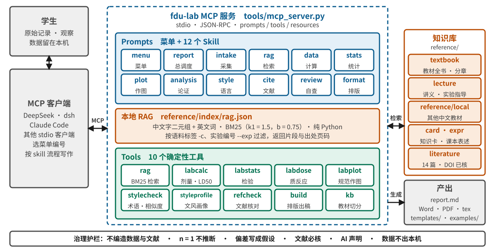
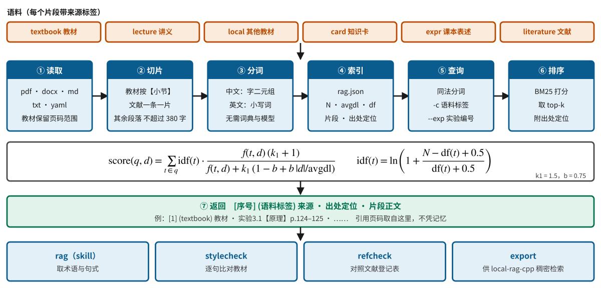
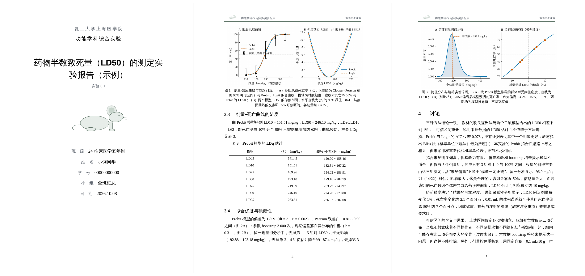
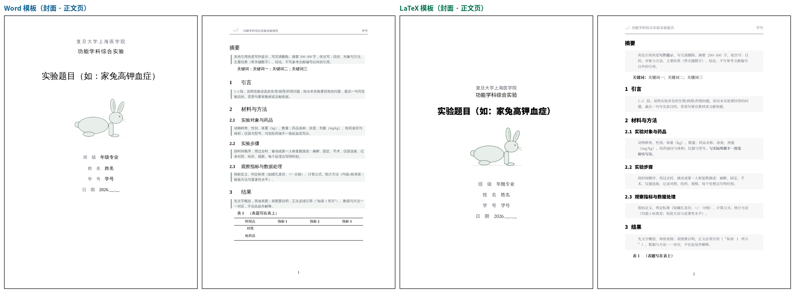

<div align="center">

# FDU Func Lab Helper

### 复旦大学《功能学科综合实验》实验报告写作助手

**本地 RAG　·　12 个 Skill　·　总菜单　·　MCP 服务**

<br>

**刘瑞琦 (Rachael Liu)**<br>
复旦大学 华山临床医学院<br>
24 级临床医学五年制<br>
<a href="mailto:24301050114@m.fudan.edu.cn">24301050114@m.fudan.edu.cn</a>

<br>

[简介](#1-简介) · [**安装**](#2-安装) · [使用](#3-使用) · [系统设计](#4-系统设计) · [RAG](#5-rag课本对齐的本地检索) · [**参考资料库**](#7-参考资料库) · [示例](#8-示例) · [**模板**](#9-模板与格式规范)

[](LICENSE)
[](tools/requirements.txt)
[](#21-npx-安装推荐)
[](tools/mcp_server.py)
[](.agents/skills)
[](#72-重点文献)



</div>

## 摘要

功能学科实验报告常见三类问题：用语偏离教材，数据与统计处理不规范，参考文献无法核实。本项目以 MCP 服务的形式提供一套完整的写作支持：**本地 RAG** 以教材、讲义、课本表述整理和重点文献为语料，使措辞贴近课本并可回到页码；**12 个 Skill 与总菜单**把写作拆分为采集、检索、计算、统计、作图、论证、语言、文献、自查、出稿；**10 个确定性工具**产出全部数字、检验、相似度、文献核对结果和排版文件。服务在本机运行，可接入 DeepSeek dsh、Claude Code 等支持 MCP 的客户端，数据保存在本机。

## 1 简介

| 组件 | 内容 | 位置 |
|---|---|---|
| **本地 RAG** | 以《功能学科实验教程》全书为主，辅以讲义、其他中文教材、知识卡、课本表述整理和重点文献；中文字二元组 BM25，返回片段与页码 | [`reference/`](reference) · [`tools/rag.py`](tools/rag.py) |
| **Skill（12）** | `menu` `report` `intake` `rag` `data` `stats` `plot` `analysis` `style` `cite` `review` `format`，每个 Skill 负责一个步骤 | [`.agents/skills/`](.agents/skills) |
| **总菜单** | 12 项功能的入口，按成本分为 L0 工具、L1 检索、L2 起草三级 | [`menu.md`](.agents/skills/fdu-lab-menu/menu.md) |
| **工具（10）** | `rag` `labcalc` `labstats` `labdose` `labplot` `stylecheck` `styleprofile` `refcheck` `build` `kb` | [`tools/`](tools) |
| **MCP 服务** | 以 prompts、tools、resources 向客户端提供上述全部能力 | [`tools/mcp_server.py`](tools/mcp_server.py) |
| **模板** | Word 与 LaTeX 通用模板，含写作内容、格式要求与字体，封面为单一线稿 | [`templates/`](templates) |
| **示例** | 药物半数致死量（LD50）报告，展示计算、拟合、稳健性分析、作图与语言流程 | [`examples/`](examples/sample-report) |

分工：模型负责理解、组织与措辞；数字、检验、引用、相似度和排版由工具产出，模型转述结果并注明来源。

## 2 安装

安装分三步：准备环境、运行安装命令、在客户端中输入“菜单”。下文给出 macOS 与 Windows 的完整终端命令，请逐行复制。使用 Linux 的同学请按所用发行版自行安装相同组件。

### 2.1 npx 安装（推荐）

**第一步：准备环境。** 需要 Node.js、Python（3.10 及以上）与 Git。

macOS：请打开“终端”（Spotlight 搜索 *终端*），依次运行：

```bash
# 安装 Homebrew（已安装请跳过）
/bin/bash -c "$(curl -fsSL https://raw.githubusercontent.com/Homebrew/install/HEAD/install.sh)"

# 安装 Node.js、Python、Git、pandoc
brew install node python git pandoc
```

Windows：请打开 PowerShell（开始菜单搜索 *PowerShell*），依次运行：

```powershell
winget install --id OpenJS.NodeJS.LTS -e
winget install --id Python.Python.3.12 -e
winget install --id Git.Git -e
winget install --id JohnMacFarlane.Pandoc -e
setx PYTHONUTF8 1
```

安装完成后，请**关闭并重新打开终端**，再检查版本：

```bash
node -v
python3 --version      # Windows 请用 python --version
git --version
```

**第二步：运行安装命令。** macOS 与 Windows 相同：

```bash
npx -y github:rachael1216/fdu-func-lab-helper
```

该命令依次完成：下载项目到 `~/fdu-func-lab-helper` → 创建虚拟环境并安装依赖 → 建立 RAG 索引 → 自检 MCP 服务。若电脑上已安装 Claude Code，服务会自动接入；其他客户端请见 2.3。

**第三步：使用。** 请进入项目目录并启动客户端：

```bash
cd ~/fdu-func-lab-helper        # Windows 请用 cd $HOME\fdu-func-lab-helper
claude                           # 或 npx @deepseek-ai/dsh web
```

在对话框输入 **菜单**，开始使用。

### 2.2 手动安装（不使用 npx）

**macOS**

```bash
cd ~/Documents
git clone https://github.com/rachael1216/fdu-func-lab-helper.git
cd fdu-func-lab-helper
python3 tools/install.py
```

**Windows（PowerShell）**

```powershell
cd $HOME\Documents
git clone https://github.com/rachael1216/fdu-func-lab-helper.git
cd fdu-func-lab-helper
python tools/install.py
```

未安装 Git 时，请在项目的 GitHub 页面点击 **Code → Download ZIP**，解压后在终端中进入该文件夹，再运行 `tools/install.py`。

脚本运行结束时，终端末尾会打印接入配置（其中的路径为本机实际路径），请复制使用：

```
✓ MCP 自检：13 个工具，13 个 prompt（菜单 + skill）
Claude Code：claude mcp add fdu-lab -- <python 路径> <mcp_server.py 路径>
```

### 2.3 接入客户端

| 客户端 | 接入方式 |
|---|---|
| **Claude Code** | 2.1 的命令已自动接入。需要手动接入时，请复制安装脚本末尾打印的 `claude mcp add …` 命令。客户端安装：`npm install -g @anthropic-ai/claude-code` |
| **DeepSeek dsh** | 请在项目目录运行 `npx @deepseek-ai/dsh web`，浏览器打开 http://127.0.0.1:3080；在 Settings → Models 填入 DeepSeek API Key，并在 MCP 服务器设置中加入下方 JSON。在项目目录启动时，dsh 还会自动发现 `.agents/skills` |
| **其他客户端** | 请把下方 JSON 加入该客户端的 `mcpServers` 配置 |

```json
{
  "mcpServers": {
    "fdu-lab": {
      "command": "npx",
      "args": ["-y", "github:rachael1216/fdu-func-lab-helper", "serve"]
    }
  }
}
```

也可以让脚本直接写入配置文件：`python3 tools/install.py --write <配置文件路径>`。

### 2.4 验证

请在客户端中依次确认：

1. 工具列表中有 `rag_search`、`lab_calc`、`lab_dose`、`style_check`、`ref_check`、`build_report` 等 13 个工具；
2. Prompt 列表中有 `menu` 与 12 个 `fdu-lab-*`；
3. 输入 **菜单**，客户端展示 12 项功能表；
4. 输入“请用 rag_search 查课本中半数致死量的术语”，返回带页码的 `textbook` 片段。

### 2.5 更新与卸载

```bash
npx -y github:rachael1216/fdu-func-lab-helper update       # 更新到最新版本
```

卸载时，请删除 `~/fdu-func-lab-helper` 文件夹，并在客户端中移除 `fdu-lab` 服务（Claude Code：`claude mcp remove fdu-lab`）。

### 2.6 排错

| 现象 | 处理 |
|---|---|
| 提示找不到 `npx` 或 `node` | 请按 2.1 安装 Node.js，并重新打开终端 |
| 提示找不到 Python | 请按 2.1 安装 Python 并重新打开终端；Windows 若仍失败，请在“应用执行别名”中关闭 Microsoft Store 的 python 别名 |
| macOS 提示 `externally-managed-environment` | 请使用 `npx` 安装或 `python3 tools/install.py`，二者都会在 `.venv` 中安装依赖，无需手动运行 `pip` |
| Windows 终端中文乱码 | 请运行 `setx PYTHONUTF8 1`，重新打开终端 |
| 首次启动较慢 | 首次启动会安装依赖并建立索引，约需 1–2 分钟 |
| `rag_search` 无结果 | 请运行 `python3 tools/rag.py build` 重建索引，并用 `python3 tools/rag.py sources` 查看语料 |
| 找不到 pandoc | 请按 2.1 安装并重新打开终端；`python3 tools/build.py --doctor` 可检查环境 |
| PDF 缺少中文 | 请安装 TeX Live 或 MiKTeX（含 ctex），或把 `.tex` 上传 Overleaf 并选择 XeLaTeX |
| `refcheck` 联网失败 | 请检查网络；也可加 `--offline` 对照登记表 |
| Word 目录为空 | 请右键目录，选择“更新域” |

## 3 使用

### 3.1 第一次使用

1. 进入项目目录并启动客户端（见 2.1 第三步）；
2. 输入 **菜单**，客户端展示 12 项功能；
3. 回复编号，或直接说明需求，例如“我要写实验 2.7 的报告”；
4. 按提示提供原始记录与观察，助手会调用检索、计算、统计、作图等工具；
5. 成稿保存在 `reports/<实验名>/`：`report.md` 与 `report.docx`，需要时还有 `.tex` 和 `.pdf`。

### 3.2 总菜单

| # | 功能 | 请提供 | 调用 | 产物 |
|---|---|---|---|---|
| 1 | 从零写一份报告 | 实验编号、原始记录、观察 | `report` 全流程 | Word / PDF |
| 2 | 查课本怎么说 | 关键词或实验编号 | `rag_search` | 片段与页码 |
| 3 | 计算数据 | 体重、剂量、浓度、读数 | `lab_calc` | 命令与结果 |
| 4 | 统计检验 | 各组数据 | `lab_stats` | 统计句与解读 |
| 5 | 作图 | CSV 或表格 | `lab_plot` | 图与图注 |
| 6 | 写分析与讨论 | 结果与观察 | `analysis` | 讨论段落 |
| 7 | 贴近课本文风（学术 humanizer） | 一段或整篇文字 | `style_profile` → 改写 → `style_check` | 差距清单与改写稿 |
| 8 | 核对参考文献 | 文献列表 | `ref_check` / `ref_format` | OK / WARN / FAIL |
| 9 | 检查整份报告 | report.md | `review` | 分级问题清单 |
| 10 | 排版出稿 | report.md | `build_report` | docx / tex / pdf |
| 11 | 获取模板 | – | `format` | 模板路径 |
| 12 | 遇到问题 | 报错信息 | 2.6 排错表 | 处理步骤 |

### 3.3 交互逻辑

```text
启动：客户端载入 MCP 服务 fdu-lab（prompts / tools / resources）

会话开始
    展示 menu                                         # fdu_lab_menu
    读取用户的编号（1–12）或自然语言需求
    skill ← route(需求)                               # report | rag | data | stats | plot | analysis | style | cite | review | format

执行 skill                                            # fdu_lab_skill(name)
    for 步骤 in skill.步骤:
        if 步骤需要课本依据:
            片段 ← rag_search(关键词, exp, corpus)    # 顺序：expr → textbook → literature
            措辞与页码取自片段；没有片段则标注“待核”
        if 步骤需要数字:
            结果 ← lab_calc | lab_stats | lab_dose | lab_plot(参数)    # 模型不自行计算
        if 步骤是写作:
            草稿 ← 写作(采集记录, 片段, 结果)
            repeat:
                问题 ← style_check(草稿) + style_profile(草稿)
                草稿 ← 按问题改写表达（数据与结论保持不变）
            until 问题已处理
        if 步骤是引用:
            状态 ← ref_check(参考文献)                # OK | WARN | FAIL | CHECK
            逐条处理 WARN 与 FAIL；作者读过原文后方可引用
        向用户说明本步产物，并确认是否继续

出稿
    build_report(report.md, to = docx | tex | pdf)
    询问：请选择下一步（回复菜单编号，或输入“菜单”）
```

### 3.4 一份报告的完整流程（菜单 1）

请对助手说：“我要写实验 2.7 家兔高钾血症的报告，请按 fdu-lab-report 带我完成。”

| 步骤 | 助手 | 作者 |
|---|---|---|
| ① 采集 | 逐组提问 | 如实提供动物、药品、时间点、原始数据、观察到的现象、与讲义不同之处 |
| ② 检索 | 取课本术语、原理句式与页码 | 核对页码与手上的教材一致 |
| ③ 计算 | `lab_calc` / `lab_dose` | 核对命令与结果 |
| ④ 统计 | `lab_stats` 选择方法并检验 | 确认分组与 n |
| ⑤ 作图 | `lab_plot` 出图并给出图注 | 查看图，修改图注 |
| ⑥ 论证 | 观察 → 预期 → 机制 → 偏差（假设）→ 局限 → 临床联系 | 补充自己的判断 |
| ⑦ 写作 | 写入 `reports/<名>/report.md` | 通读并改写为自己的表达 |
| ⑧ 语言 | `style_profile` 与 `style_check` | 决定取舍，改写与课本过近的句子 |
| ⑨ 文献 | `ref_check` | 读过原文再引用，处理全部 WARN 与 FAIL |
| ⑩ 自查 | `review` 清单 | 逐项确认 |
| ⑪ 出稿 | `build_report` | 打开检查；按课程要求声明 AI 使用情况 |

报告头（YAML）：

```yaml
---
title: 家兔高钾血症实验报告
course: 功能学科综合实验
exp_no: "2.7"
class: 24 临床医学五年制
student: 姓名
student_id: "学号"
date: 2026.11.13
animal: rabbit          # rabbit 或 mouse，决定封面线稿
ai_statement: ""        # 按课程要求填写，非空时附在文末
---
```

个人报告请放在 `reports/`（该目录已被 `.gitignore` 忽略）。

### 3.5 在终端中直接使用工具

```bash
python3 tools/rag.py search 半数致死量 改良寇氏法 --exp 8.1 -c expr          # 课本术语与页码
python3 tools/labcalc.py dose --weight 2.5 --dose 1000 --conc 20              # 给药体积
python3 tools/labstats.py anova --g 对照=1,2,3 --g 低=2,3,4 --g 高=5,6,7      # 单因素方差分析
python3 tools/labdose.py --dose 110.8 147.7 196.9 262.5 350 --n 22 --deaths 0 1 14 20 22 --figs figs/
python3 tools/labplot.py bar data.csv --x 组别 --y 数值 --points -o fig1.png
python3 tools/stylecheck.py reports/某实验/report.md --exp 8.1
python3 tools/refcheck.py reports/某实验/report.md
python3 tools/build.py reports/某实验/report.md --to all
```

每个工具使用 `-h` 可查看完整说明；CSV 采用长表，每行一次观测。

## 4 系统设计

### 4.1 MCP 接口

服务由 [`tools/mcp_server.py`](tools/mcp_server.py) 提供，仅依赖 Python 标准库，实现 `initialize`、`tools/*`、`prompts/*`、`resources/*`，以行分隔的 JSON-RPC 通过 stdio 通信。

| 类别 | 条目 | 说明 |
|---|---|---|
| **Prompts**（13） | `menu`；`fdu-lab-report` `-intake` `-rag` `-data` `-stats` `-plot` `-analysis` `-style` `-cite` `-review` `-format` `-menu` | 客户端可直接选用；正文前附有命令行与 MCP 工具的对应表 |
| **Tools**（13） | `fdu_lab_menu` `fdu_lab_skill` `rag_search` `rag_sources` `lab_calc` `lab_stats` `lab_dose` `lab_plot` `style_check` `style_profile` `ref_check` `ref_format` `build_report` | 与 `tools/*.py` 一一对应，参数与命令行一致 |
| **Resources** | `fdu-lab://menu` `fdu-lab://format` `fdu-lab://references` `fdu-lab://skill/<name>` | 菜单、格式规范、文献目录、各 Skill 原文 |

### 4.2 分层

| 层 | 目录 | 职责 |
|---|---|---|
| 入口 | `tools/mcp_server.py`、`AGENTS.md`、`menu.md` | 会话启动、菜单路由、协议 |
| Skill | `.agents/skills/` | 写明触发条件、步骤、调用的工具与边界 |
| 工具 | `tools/` | 确定性计算与检查：参数进，stdout 出，退出码表示成败 |
| 知识 | `reference/` | RAG 语料与文献登记表，每个片段带来源标签 |
| 产出 | `templates/`、`examples/` | 模板、示例、Word / tex / PDF |

### 4.3 Skill

| Skill | 触发 | 调用 | 产出 |
|---|---|---|---|
| `menu` | 新会话 | 菜单 | 12 项路由 |
| `report` | 写整份报告 | 其余全部 | 流水线编排与硬规则 |
| `intake` | 采集信息 | – | 结构化记录 |
| `rag` | 需要课本措辞与页码 | `rag_search` | 片段与出处 |
| `data` | 计算 | `lab_calc` | 命令与结果 |
| `stats` | 多组比较 | `lab_stats` | 统计句 |
| `plot` | 作图 | `lab_plot` | 图与图注 |
| `analysis` | 写讨论 | `expr`、`card` | 论证段落 |
| `style` | 润色 | `style_profile`、`style_check` | 差距清单与改写 |
| `cite` | 参考文献 | `ref_check` | 核对清单 |
| `review` | 整份检查 | 以上工具 | 分级问题清单 |
| `format` | 出稿与模板 | `build_report` | docx / tex / pdf |

### 4.4 工具

| 工具 | 算法与要点 |
|---|---|
| `rag.py` | 字二元组 BM25；按语料标签与实验编号过滤；输出出处定位 |
| `labcalc.py` | 教材公式：给药体积、稀释还原、改良寇氏法 LD50、治疗指数、MAP、AChE 活力、肺系数、HRV、Fisher 精确检验 |
| `labstats.py` | SciPy：描述统计、Shapiro–Wilk、Welch / 配对 / 等方差 t 检验、单因素 ANOVA 与 Tukey、Mann–Whitney、Pearson / Spearman、线性回归；给出方法选择建议；n < 2 时报错退出 |
| `labdose.py` | 质反应分析：改良寇氏法 LD50 与 95% CI；Probit / Logit 二项最大似然、似然剖面区间（LRT 3.841）、AIC、偏差与 Pearson 残差、参数 bootstrap、留一剂量组、LDq 表、局部剂量敏感性；输出三幅图 |
| `labplot.py` | Okabe–Ito 色盲友好配色，刻度朝内，SD / SEM 可选并生成建议图注 |
| `stylecheck.py` | 术语覆盖、模板腔词表、逐句与课本相似度（≥ 0.60 过近，< 0.15 缺依据）、数字单位与标点 |
| `styleprofile.py` | 课本文风画像：句长分布、逗号密度、连接词频率、句首多样性、跨实验高频搭配；`compare` 对照报告 |
| `refcheck.py` | DOI 对照 Crossref：题名、第一作者、年份、卷、页；无 DOI 时给出候选；`--offline` 对照登记表；`fmt` 生成 GB/T 7714 条目 |
| `build.py` | Markdown + YAML → pandoc → docx（封面分节、罗马与阿拉伯页码、三线表、页眉）或 tex（`fdureport.cls`）→ PDF |
| `kb.py` | 教材 PDF 按实验编号切分为分章文本，保留页码 |

### 4.5 分析的三道防线

1. **确定性**：计算、统计、作图全部由代码完成。
2. **有据**：机制句来自课本或登记文献，找不到依据时标注“待核”。
3. **论证协议**：观察（事实）→ 与预期比较 → 机制 → 偏差作为假设并给出验证方式 → 局限 → 临床联系；n = 1 只描述，多组数据才做检验。

## 5 RAG：课本对齐的本地检索

报告的措辞（术语、机制表述、判定标准）应与课本一致，引用的页码应能回到出处。RAG 在写作前取出课本表述，写作后再以同一语料反向检查。

<div align="center"></div>

### 5.1 语料

| 标签 | 位置 | 内容 | 切片粒度 |
|---|---|---|---|
| `textbook` | `reference/textbook/` | 《功能学科实验教程》PDF 与分章文本 | 按【目的】【原理】【步骤】等小节，带页码范围 |
| `lecture` | `reference/lecture/` | 讲义、实验指导 | 不超过 380 字的段落 |
| 目录名 | `reference/local/<目录>/` | 其他中文教材（《生理学》《病理生理学》《药理学》等）、文献全文 | 不超过 380 字的段落 |
| `card` | `reference/cards/` | 机制链、预期现象、常见偏差、临床联系（33 张） | 按 “## ” 小节 |
| `expr` | `reference/expressions/` | 各实验的课本术语、句式、页码（7 个实验与通用写法） | 按 “## ” 小节 |
| `literature` | `reference/literature/references.yaml` | 重点文献书目与要点（14 篇） | 一条一片 |

课本以外的重点文献优先进入 RAG；放入 `reference/local/` 的资料只在本机建立索引，不会被提交。

### 5.2 检索协议与算法

```bash
python3 tools/rag.py search 肺牵张反射 迷走神经 --exp 3.1 -c textbook --full
python3 tools/rag.py search 复能剂 -c literature -k 3
```

1. `-c expr --exp <编号>`：取该实验的术语表与句式；
2. `-c textbook --full`：阅读课本原文，采用课本的术语与判定标准，用自己的句子表述；
3. 课本以外的内容查 `-c literature` 或 `reference/local/`，仍无依据时标注“待核”。

分词：中文取相邻汉字二元组，英文取小写词。排序采用 BM25：

$$\mathrm{score}(q,d)=\sum_{t\in q}\mathrm{idf}(t)\cdot\frac{f(t,d)\,(k_1+1)}{f(t,d)+k_1\left(1-b+b\,\frac{|d|}{\mathrm{avgdl}}\right)}$$

$$\mathrm{idf}(t)=\ln\!\left(1+\frac{N-\mathrm{df}(t)+0.5}{\mathrm{df}(t)+0.5}\right),\qquad k_1=1.5,\ b=0.75$$

索引文件 `reference/index/rag.json` 记录 $N$、平均长度、$\mathrm{df}$，以及每个片段的语料标签、来源和出处定位（如“实验 3.1【原理】p.124–125”）。

### 5.3 与 local-rag-cpp

作者的另一个项目 [**local-rag-cpp**](https://github.com/rachael1216/local-rag-cpp) 以 C++ 与 llama.cpp 实现本地稠密向量检索和问答，与本项目分工如下：

| | 本项目 `rag.py` | local-rag-cpp |
|---|---|---|
| 检索 | 词法 BM25 | 稠密向量（余弦相似度） |
| 擅长 | 术语精确匹配、页码出处、与 Skill 和工具联动 | 同义改写、整句自然语言提问 |
| 依赖 | Python 标准库 | CMake、GCC 14、GGUF 模型 |

`python3 tools/rag.py export` 可把全部语料导出为带“第 N 章”标题的纯文本，作为 local-rag-cpp 的输入。

## 6 语言：从课本学文风

写作语言应贴近课本。流程分三步，对应菜单第 7 项：

| 步骤 | 内容 | 工具 |
|---|---|---|
| ① 画像 | 对照课本说明性段落（目的、原理、思考题）统计出的文风：句长分布、逗号密度、连接词频率、句首多样性、该实验可采用的课本搭配 | `style_profile` |
| ② 改写 | 按差距清单改表达：术语对齐，拆分长句，删去口语与模板腔，有数据时写出数据；数据与结论保持不变 | Skill `fdu-lab-style` |
| ③ 验证 | 术语覆盖、模板腔、逐句与课本的相似度、数字与标点格式 | `style_check` |

文风画像由 `reference/textbook/` 生成，保存在 `reference/style/profile.json`，取其表达方式；直接引用课本时请加引号并标注页码。AI 的使用情况请按课程要求写入 `ai_statement`。

## 7 参考资料库

> **`reference/` 集中存放 RAG 的全部原料与文献目录。** 报告模板见[第 9 节](#9-模板与格式规范)。

### 7.1 教材与讲义

| 编号 | 文献（GB/T 7714—2015） | 位置 | 检索标签 |
|---|---|---|---|
| [M1] | 严钰锋, 马淑兰. 功能学科实验教程[M]. 2020. | [`reference/textbook/`](reference/textbook)（PDF，219 页；`ex_*.md` 为按实验切分的文本，含页码） | `textbook` |
| [M2] | 课程讲义、实验指导 | `reference/lecture/` | `lecture` |
| [M3] | 《生理学》《病理生理学》《药理学》等同类中文教材 | `reference/local/<目录>/`（自行放入，不提交） | 目录名 |

放入新资料后，请运行 `python3 tools/rag.py build`；教材的页码范围由 `tools/kb.py build` 写入分章文本。

### 7.2 重点文献

下列 14 篇文献的书目均已用 Crossref 的 DOI 接口核对（题名、作者、刊名、年份、卷期页），要点以概括的方式写入登记表 [`references.yaml`](reference/literature/references.yaml)，检索标签为 `literature`。带关键词的完整目录见 [`reference/literature/README.md`](reference/literature/README.md)。

<!-- REFLIST:START -->
| 序号 | 文献（GB/T 7714—2015） | 实验 |
|---|---|---|
| [1] | EDDLESTON M, BUCKLEY N A, EYER P, et al. Management of acute organophosphorus pesticide poisoning[J]. The Lancet, 2008, 371(9612): 597-607. DOI: 10.1016/S0140-6736(07)61202-1. | 1.5 |
| [2] | EDDLESTON M. Novel clinical toxicology and pharmacology of organophosphorus insecticide self-poisoning[J]. Annual Review of Pharmacology and Toxicology, 2019, 59: 341-360. DOI: 10.1146/annurev-pharmtox-010818-021842. | 1.5 |
| [3] | EDDLESTON M, EYER P, WOREK F, et al. Pralidoxime in acute organophosphorus insecticide poisoning—a randomised controlled trial[J]. PLoS Medicine, 2009, 6(6): e1000104. DOI: 10.1371/journal.pmed.1000104. | 1.5 |
| [4] | ELLMAN G L, COURTNEY K D, ANDRES V Jr, et al. A new and rapid colorimetric determination of acetylcholinesterase activity[J]. Biochemical Pharmacology, 1961, 7(2): 88-95. DOI: 10.1016/0006-2952(61)90145-9. | 1.5 |
| [5] | BRIGGS G E, HALDANE J B S. A note on the kinetics of enzyme action[J]. Biochemical Journal, 1925, 19(2): 338-339. DOI: 10.1042/bj0190338. | 1.5 |
| [6] | SCHILD H O. pA, a new scale for the measurement of drug antagonism[J]. British Journal of Pharmacology and Chemotherapy, 1947, 2(3): 189-206. DOI: 10.1111/j.1476-5381.1947.tb00336.x. | 1.5, 5.2 |
| [7] | ARUNLAKSHANA O, SCHILD H O. Some quantitative uses of drug antagonists[J]. British Journal of Pharmacology and Chemotherapy, 1959, 14(1): 48-58. DOI: 10.1111/j.1476-5381.1959.tb00928.x. | 5.2, 1.5 |
| [8] | WEISBERG L S. Management of severe hyperkalemia[J]. Critical Care Medicine, 2008, 36(12): 3246-3251. DOI: 10.1097/CCM.0b013e31818f222b. | 2.7 |
| [9] | LEVI M, TEN CATE H. Disseminated intravascular coagulation[J]. New England Journal of Medicine, 1999, 341(8): 586-592. DOI: 10.1056/NEJM199908193410807. | 4.3 |
| [10] | TAYLOR F B Jr, TOH C H, HOOTS W K, et al. Towards definition, clinical and laboratory criteria, and a scoring system for disseminated intravascular coagulation[J]. Thrombosis and Haemostasis, 2001, 86(11): 1327-1330. DOI: 10.1055/s-0037-1616068. | 4.3 |
| [11] | SEMENZA G L. Oxygen sensing, homeostasis, and disease[J]. New England Journal of Medicine, 2011, 365(6): 537-547. DOI: 10.1056/NEJMra1011165. | 3.2 |
| [12] | LEI M, WU L, TERRAR D A, et al. Modernized classification of cardiac antiarrhythmic drugs[J]. Circulation, 2018, 138(17): 1879-1896. DOI: 10.1161/CIRCULATIONAHA.118.035455. | 2.4, 2.4s |
| [13] | SANDERS K M, KOH S D, RO S, et al. Regulation of gastrointestinal motility—insights from smooth muscle biology[J]. Nature Reviews Gastroenterology & Hepatology, 2012, 9(11): 633-645. DOI: 10.1038/nrgastro.2012.168. | 5.2 |
| [14] | LORKE D. A new approach to practical acute toxicity testing[J]. Archives of Toxicology, 1983, 54(4): 275-287. DOI: 10.1007/BF01234480. | 8.1 |
<!-- REFLIST:END -->

查看某实验可用的文献：`python3 tools/rag.py search 关键词 -c literature --exp 1.5`。

### 7.3 新增文献

```bash
python3 tools/refcheck.py fmt 10.1016/S0140-6736(07)61202-1   # 由 DOI 生成 GB/T 7714 条目并核对
# 把条目写入 reference/literature/references.yaml（含 verified 字段）
python3 tools/dev/make_reflist.py                              # 更新本节与文献目录
python3 tools/refcheck.py --registry                           # 联网复核全部登记条目
```

### 7.4 参考文献格式（GB/T 7714—2015，顺序编码制）

| 类型 | 格式 |
|---|---|
| 期刊 | 作者. 题名[J]. 刊名, 年, 卷(期): 起止页. DOI. |
| 图书 | 作者. 书名[M]. 出版地: 出版者, 年: 页码. |
| 作者 | 西文姓大写、名缩写，超过 3 位时列前 3 位并加 “, et al”；中文作者写全名 |
| 正文引用 | 按出现顺序编号，写作 [1]、[1,3]、[2–4] |

## 8 示例

<div align="center"><br>
<sub>示例报告《药物半数致死量（LD50）的测定》：封面 · 图 1 剂量–效应曲线与似然剖面及 LDq 表 · 图 3 阈值分布与给药误差传播（<a href="examples/sample-report/report.md">源文件</a> · <a href="examples/sample-report/report.docx">Word</a>）</sub></div>

示例以课堂实验的汇总数据（110 只小鼠，5 个剂量组，每组 22 只）为输入，展示各工具如何产出报告中的数字与图：

| 环节 | 工具 | 示例中的产出 |
|---|---|---|
| 教材方法 | `labcalc ld50` | 改良寇氏法 LD50 = 191.85 mg/kg，95% CI 178.25–206.48 |
| 模型比较 | `labdose` | Probit 193.10、Logit 191.92 mg/kg；AIC 13.823 / 13.901；偏差 1.859（P = 0.602） |
| 稳健性（图 2） | `labdose` | Pearson 残差、参数 bootstrap（3 000 次）、留一剂量组 LD50 范围 187.4–203.5 mg/kg |
| 局部敏感性（图 3） | `labdose` | 阈值耐受分布；给药体积 ±0.01 mL 对应的死亡率偏离 |
| 语言 | `style_profile`、`style_check` | 术语覆盖与相似度检查 |
| 文献 | `ref_check` | 参考文献逐项核对 |

报告附录列出了可复现的全部命令。

## 9 模板与格式规范

通用模板由写作内容、格式要求与字体三部分组成，Word 与 LaTeX 各一份。封面为单一极简线稿（兔或小鼠，由 `animal` 选择），正文页带页眉。

<div align="center"></div>

### 9.1 文件

| 文件 | 说明 |
|---|---|
| [`templates/word/功能学科实验报告模板.docx`](templates/word/功能学科实验报告模板.docx) | Word 通用模板：封面、目录、页眉，各节附写作提示 |
| [`templates/word/reference.docx`](templates/word/reference.docx) | Word 样式母版，`build.py` 据此生成 docx |
| [`templates/latex/report-template.tex`](templates/latex/report-template.tex) | LaTeX 通用模板源文件 |
| [`templates/latex/report-template.pdf`](templates/latex/report-template.pdf) | LaTeX 模板的编译预览（XeLaTeX） |
| [`templates/latex/fdureport.cls`](templates/latex/fdureport.cls) | LaTeX 文档类（基于 ctexart） |
| [`templates/latex/pandoc-fdulab.latex`](templates/latex/pandoc-fdulab.latex) | pandoc 的 LaTeX 母版，`build.py --to tex` 使用 |
| [`templates/report-skeleton.md`](templates/report-skeleton.md) | Markdown 骨架，供 `build.py` 出稿 |
| [`templates/cover/`](templates/cover) | 封面线稿：[兔](templates/cover/rabbit.png) · [小鼠](templates/cover/mouse.png)（含 PDF 矢量版与页眉图标） |
| [`templates/FORMAT.md`](templates/FORMAT.md) | 完整格式规范：结构、字体、数字与单位、表、图、参考文献 |
| [`examples/sample-report/report.docx`](examples/sample-report/report.docx) | 按模板生成的完整示例 |

### 9.2 使用方式

- **Word**：下载 docx 模板，按各节提示填写；或用 `build.py` 由 Markdown 直接生成。
- **LaTeX**：把 `templates/latex/` 文件夹整体上传 Overleaf，编译器选择 XeLaTeX；本机编译需安装 TeX Live 或 MiKTeX（含 ctex）。
- **Markdown**：复制 `templates/report-skeleton.md`，填写后运行 `python3 tools/build.py <文件> --to all`。

### 9.3 主要规定

| 项目 | 规定 |
|---|---|
| 版面 | A4；上下 2.54 cm，左右 3.0 cm |
| 正文 | 宋体（西文 Times New Roman），小四，1.5 倍行距，首行缩进 2 字符 |
| 标题 | 黑体：一级三号、二级四号、三级小四，加粗 |
| 图表 | 三线表；表题在上，图题在下，宋体五号；图注写明 n 与误差线含义 |
| 页码 | 目录用罗马数字，正文用阿拉伯数字 |
| 结构 | 摘要（200–300 字）→ 引言 → 材料与方法 → 结果 → 讨论 → 结论 → 参考文献 → 附录 |

## 10 目录结构

```
fdu-func-lab-helper/
├─ README.md  AGENTS.md  CITATION.cff  LICENSE  package.json
├─ .agents/skills/           12 个 Skill；fdu-lab-menu/menu.md 为总菜单
├─ reference/                RAG 原料
│  ├─ textbook/              教材 PDF 与分章文本
│  ├─ lecture/  local/       讲义；其他教材与文献全文（local 不提交）
│  ├─ cards/  expressions/   知识卡；课本表述整理
│  ├─ literature/            文献登记表与目录
│  ├─ style/                 文风画像与避免用语
│  └─ index/                 检索索引（自动生成）
├─ templates/                Word · LaTeX · Markdown 模板、封面线稿、格式规范
├─ examples/sample-report/   示例报告
├─ tools/                    工具、MCP 服务、安装脚本（dev/ 为开发脚本）
├─ tests/                    单元测试
└─ .github/                  CI 与 README 插图
```

## 11 开发与测试

```bash
python3 -m unittest discover tests                              # 单元测试
python3 tools/card_index.py --check                             # 知识卡校验
python3 tools/refcheck.py --offline examples/sample-report/report.md
python3 tools/dev/make_arch.py                                  # 重新生成架构图与 RAG 图
python3 tools/dev/render_tex.py                                 # 重新生成 LaTeX 模板预览
```

提交时请遵循：数字与引用由工具产出；新增知识卡须通过 `card_index --check`；新增文献须先用 `refcheck fmt` 核对；不提交学生个人报告（`reports/`）。CI（[`ci.yml`](.github/workflows/ci.yml)）运行测试并构建示例。

## 12 引用与许可

```bibtex
@software{liu2026fdufunclab,
  author  = {刘瑞琦},
  title   = {FDU Func Lab Helper: 复旦大学《功能学科综合实验》实验报告写作助手},
  year    = {2026},
  url     = {https://github.com/rachael1216/fdu-func-lab-helper}
}
```

代码以 [MIT](LICENSE) 发布。第三方组件：pandoc（GPL，外部程序）、python-docx（MIT）、PyYAML（MIT）、SciPy 与 NumPy（BSD-3）、matplotlib（matplotlib License）、PyMuPDF（可选，AGPL，仅本机使用）、XeLaTeX 与 ctex（LPPL）。文献书目来自 Crossref REST API。教材版权归出版社所有。
