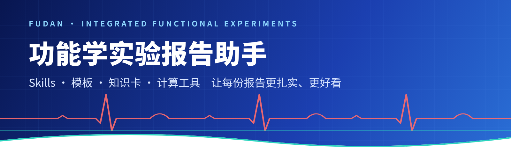
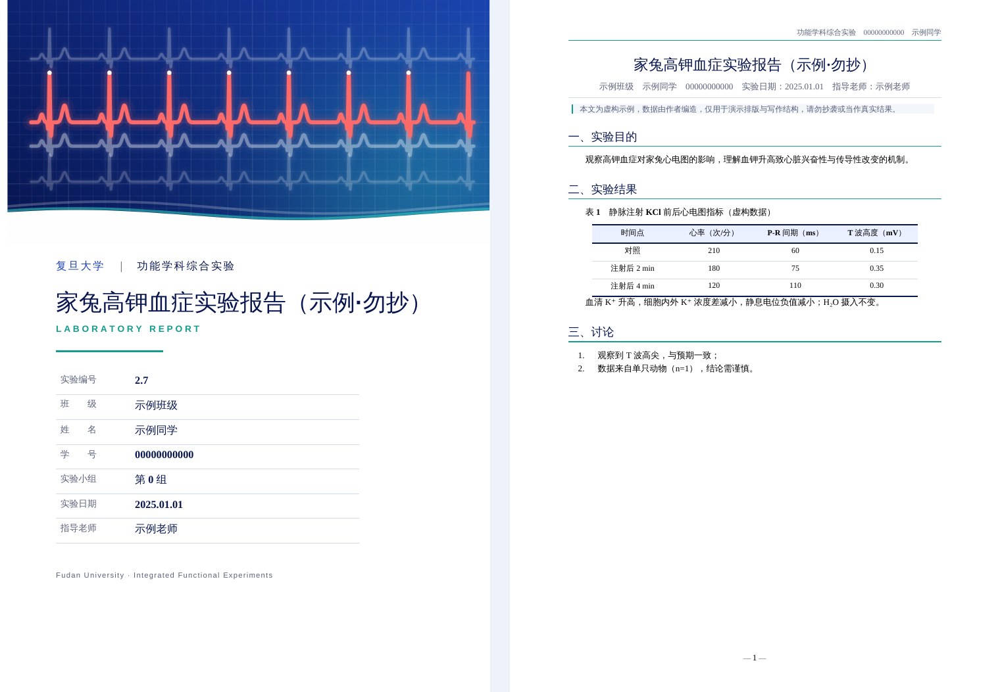
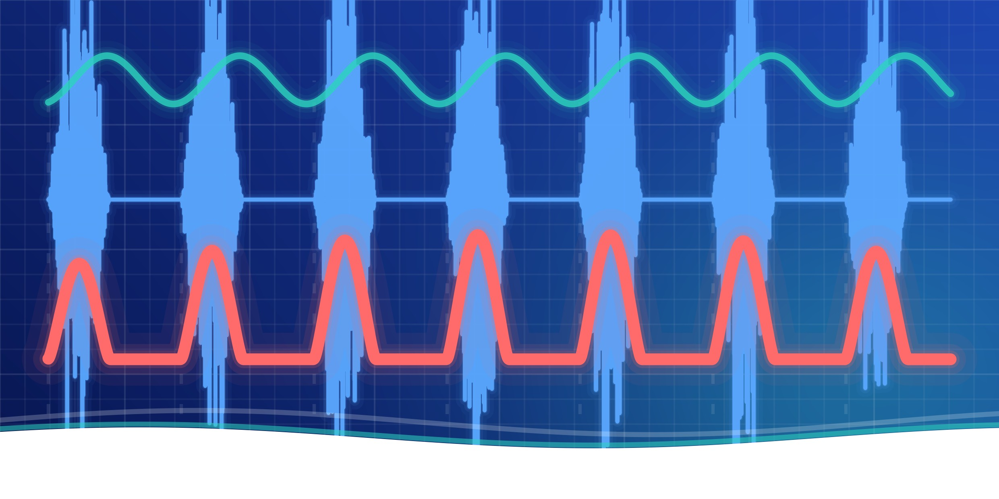
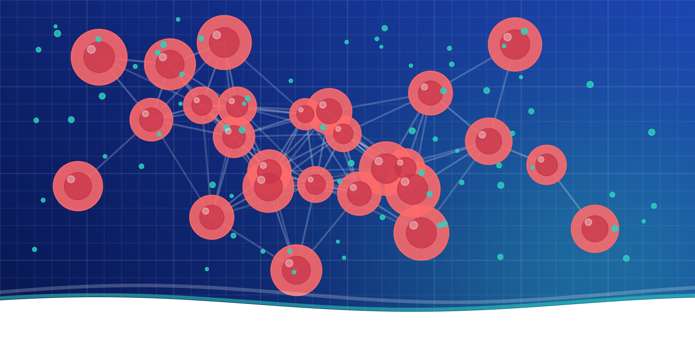
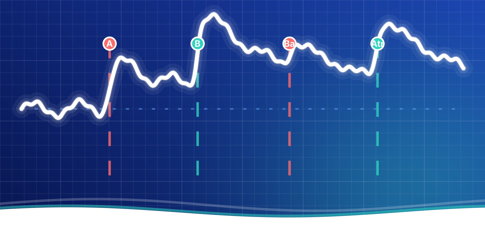
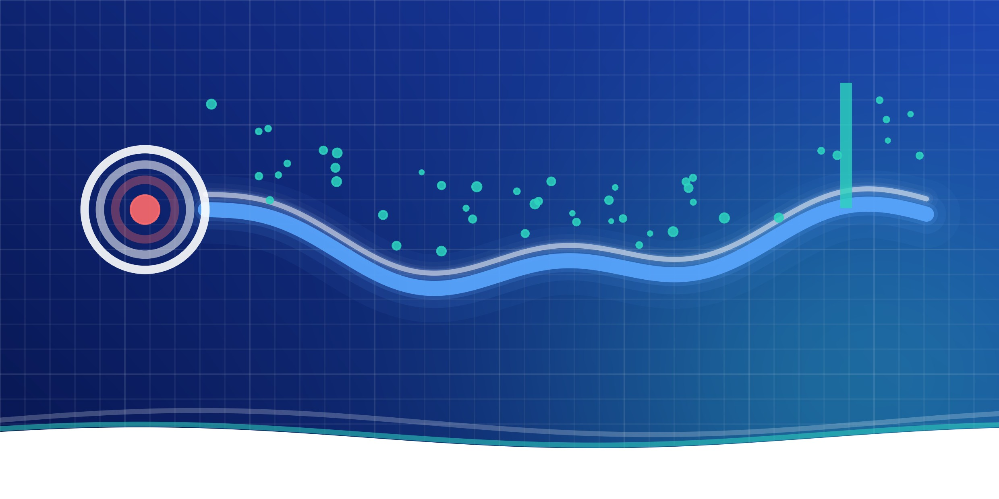
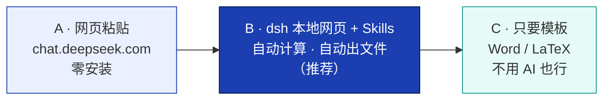
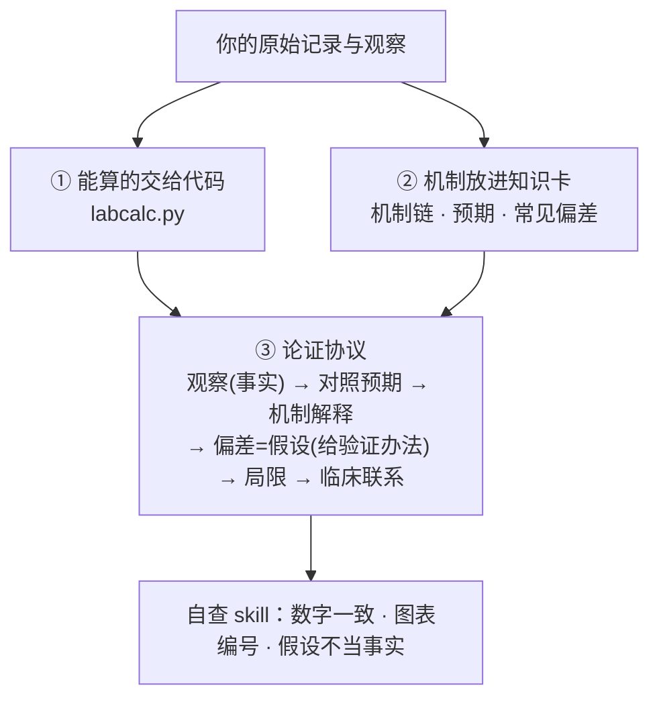

<div align="center">



# FDU Func Lab Helper

**复旦《功能学科综合实验》报告助手**　·　6 个 Skill　·　Word/LaTeX 精美模板　·　33 张实验知识卡　·　可靠的计算工具

[](.github/workflows/ci.yml)
[](LICENSE)
[](.agents/skills)
[-FF6B6B?style=flat-square)](knowledge/cards)
[](#)

[快速开始](docs/01-快速开始.md) · [设计思路](docs/02-设计思路.md) · [FAQ](docs/03-FAQ.md) · [学术诚信](docs/04-学术诚信与隐私.md) · [贡献](CONTRIBUTING.md)

</div>

---

## ✨ 它能做什么

| | |
|---|---|
| 🧭 **写作教练 Skill** | 采集记录 → 查知识卡 → 算数据 → 写分析 → 自查 → 一键出文件。教你写，不替你编。 |
| 🎨 **带封面的模板** | Word 与 LaTeX 各一套，8 个系统主题封面（心血管/神经/呼吸/药理/血液/消化/泌尿/通用）。 |
| 🧮 **不会算错的工具** | `labcalc.py`：剂量、稀释、MAP、LD50（改良寇氏法）、治疗指数、AChE 活性、Fisher 检验……单元测试对照教材例题。 |
| 📚 **实验知识卡** | 33 个实验的机制链、预期现象、常见偏差、临床联系，讨论部分有据可依。 |
| 🔍 **教材本地索引** | 用你自己的教材 PDF 在本机建索引，按实验编号取原文与页码（教材不随仓库分发）。 |
| 🤝 **零服务器** | 每位同学用自己的 DeepSeek 账号，数据留在本机。 |

## 🖼️ 成品长什么样

<div align="center">

<br><sub>示例为虚构数据，仅演示排版（<a href="examples/sample-report/report.md">源文件</a>）</sub>
</div>

### 封面主题

<table>
<tr>
<td align="center"><br><sub>cardio 心血管</sub></td>
<td align="center"><br><sub>neuro 神经</sub></td>
<td align="center"><br><sub>resp 呼吸</sub></td>
<td align="center"><br><sub>pharm 药理</sub></td>
</tr>
<tr>
<td align="center"><br><sub>blood 血液</sub></td>
<td align="center"><br><sub>gi 消化</sub></td>
<td align="center"><br><sub>renal 泌尿</sub></td>
<td align="center"><br><sub>general 通用</sub></td>
</tr>
</table>

## 🚀 三种用法，选一种



**方案 B（推荐）三步走**

```bash
git clone https://github.com/rachael1216/fdu-func-lab-helper.git && cd fdu-func-lab-helper
pip install -r requirements.txt && python tools/build.py --doctor   # 检查环境
npx @deepseek-ai/dsh web                                             # 浏览器打开 http://127.0.0.1:3080
```

在 *Settings → Models* 填入你的 DeepSeek API Key，然后对它说：

> 我要写家兔高钾血症（实验 2.7）的报告，请用 fdu-lab-report 带我做。

完整图文步骤（含 Node / API Key / pandoc 安装）：**[docs/01-快速开始.md](docs/01-快速开始.md)**

> 💡 **dsh** 在此指 DeepSeek 的本地 agent 运行环境（DeepSeek Harness）。skill 的加载方式依据公开说明编写，尚未在所有环境验证；遇到问题请先用方案 A 并提 Issue。

## 🧠 分析部分怎么解决？

AI 最容易在“讨论”里空话或编造。我们分三层：



详见 **[设计思路](docs/02-设计思路.md)**（Agent / Skill / RAG 的取舍、为什么不用服务器）。

## 🧩 Skills

| Skill | 作用 |
|---|---|
| `fdu-lab-report` | 总流程：采集 → 计算 → 分析 → 自查 → 生成 |
| `fdu-lab-intake` | 对话式采集原始记录与“与讲义不同之处” |
| `fdu-lab-data` | 调用 `labcalc.py`，禁止心算 |
| `fdu-lab-analysis` | 结果与讨论的论证协议 |
| `fdu-lab-review` | 报告自查清单 |
| `fdu-lab-kb` | 查知识卡与本地教材索引 |

## 🗂️ 仓库结构

```
.agents/skills/     6 个 skill（dsh 与其他 agent 自动发现）
knowledge/cards/    实验知识卡（AI 起草，欢迎审校）
templates/          Word 母版与填写模板 · LaTeX 类与模板
assets/covers/      8 个主题封面
tools/              build.py 一键排版 · labcalc.py 计算 · kb.py 教材索引 · make_prompt.py
examples/           虚构示例报告
docs/               快速开始 · 设计思路 · FAQ · 学术诚信
```

## ⚠️ 请注意

- **学术诚信**：这是写作教练，不是代笔。数据与观察必须是你自己的；请按课程要求声明 AI 使用。示例报告为虚构，**勿抄**。
- **知识卡是 AI 起草、未经教师审校**（`review_status: draft-ai`），请以教材与老师为准，发现错误欢迎 PR。
- **教材不在仓库**（版权）。可用自己的 PDF 在本机建索引：`python tools/kb.py build 教材.pdf`。
- LaTeX 版需 XeLaTeX + ctex（TeX Live / MiKTeX / Overleaf）。
- 本项目为同学自发的非官方工具，与学校及课程组无隶属关系。

## 🛣️ 路线图

- [ ] 教师/高年级审校知识卡
- [ ] 本地小界面（一键填表生成）
- [ ] 图表 skill：CSV → 规范曲线/柱状图
- [ ] 更多实验的完整卡片

## 🤝 贡献

最需要的是**审校知识卡**，见 [CONTRIBUTING](CONTRIBUTING.md)。

## 📄 License

MIT © rachael1216
