> **示例说明**　本例改编自作者本人的一份课程作业：姓名、学号、指导教师与组别已隐去，**保留原始记录图与文字结构**，仅用于演示版式、写作结构与“描述性分析”的写法。请勿抄袭，请用你自己的实验记录。

# 实验目的
（1）学习家兔气管插管及膈肌放电记录方法，认识膈肌节律性活动与呼吸运动的关系。

（2）观察吸入氮气、二氧化碳及注射乳酸、尼可刹米时的放电变化，理解呼吸的化学性调节与药物影响。

（3）比较肺充气、抽气以及迷走神经切断前后的记录，分析肺牵张反射与迷走神经传入对呼吸的调节作用。

# 实验方法
## 实验动物与记录指标
实验对象为家兔，采用膈肌放电记录观察吸气活动。主要比较各处理时段的放电簇节律、幅度及持续情况。各截图为不同处理时段的记录，采用描述性比较，不将其作为独立动物重复进行显著性检验。

## 实验药品与器材
氮气、二氧化碳、生理盐水、乳酸及尼可刹米；哺乳动物手术器械、气管插管、注射器与橡皮管、膈肌引导电极及生物信号采集系统。麻醉、气管插管和膈肌暴露方法参照教材实验3.1[1]。

## 实验操作与观察项目
（1）家兔麻醉、固定后建立气管通路，分离双侧颈迷走神经并穿线备用，暴露膈肌、固定引导电极，调节信号增益并记录初始曲线。

（2）分别观察吸入氮气、二氧化碳时的记录；通过气管插管进行充气和抽气，观察肺容积改变时的放电变化。教材要求在吸气末充气、呼气末抽气，并在撤除刺激、记录稳定后进行下一项操作[1]。

（3）比较生理盐水、乳酸及尼可刹米处理时段。教材所列标准方案为静脉注射生理盐水1
mL/kg、3%乳酸1～2 mL/kg、10%尼可刹米1
mL/kg并缓慢推注；上述为教材用量，实际给药量应以当堂操作记录为准[1]。

（4）比较迷走神经切断前、单侧切断及双侧切断时的记录，并整理"重复抽吸"曲线。图序沿用原始资料标签，操作先后判断同时参考截图时间轴。

## 数据读取方法
逐图抄录软件显示的记录时长、频率参数、最大值、最小值及峰峰值。纵轴为微伏（µV），反映电信号幅度，不能直接等同于潮气量。软件"频率"参数的测量定义未明确，故保留原读数，不直接换算为每分钟呼吸次数；节律变化依据放电簇间隔作定性比较。

# 实验结果
## 实验数据汇总
12个处理时段的软件读数见表1，原始曲线见图1～12。表中数据均按截图显示值记录，峰峰值采用软件直接读数，保留原显示精度。

**表1 各处理时段原始软件读数**

  -----------------------------------------------------------------------------
  **处理**          **时长\   **软件频率\   **最大值\   **最小值\   **峰峰值\
                    （s）**   （Hz）**      （µV）**    （µV）**    （µV）**
  ----------------- --------- ------------- ----------- ----------- -----------
  初始              14.53     2.97          252         -353        605

  吸入N₂            12.57     3.58          846         -783        1630

  吸入CO₂           15.26     2.19          630         -730        1360

  打气              11.15     3.19          172         -332        504

  抽气              9.48      7.20          599         -471        1070

  生理盐水          13.81     1.03          142         -191        332

  乳酸              14.18     3.73          312         -361        673

  尼可刹米          14.17     1.94          217         -266        483

  剪断迷走前        14.24     0.81          184         -194        378

  单侧迷走切断      14.16     2.42          268         -320        588

  双侧迷走记录      14.33     1.46          650         -623        1273

  重复抽吸          14.35     1.70          632         -533        1165
  -----------------------------------------------------------------------------

注：软件频率读数与呼吸频率属于不同层面的指标，在缺乏测量定义和放电簇计数时不作等同解释。各时段的峰峰值反映截图内信号范围，可能受电极、增益及操作伪差影响。

总体上，氮气和二氧化碳时段的放电幅度较初始记录增大；乳酸、尼可刹米时段的放电簇较生理盐水时段密集；双侧迷走记录较切断前呈现更大的簇状幅度和更长的簇间间隔。下面结合原始图分别描述。

## 初始记录与吸入氮气
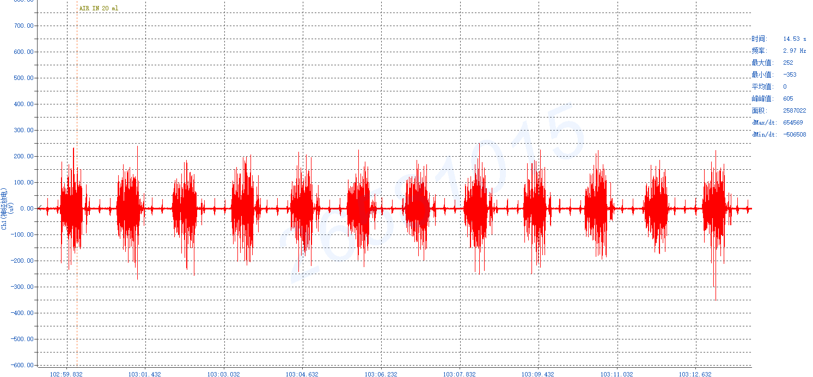{width=85%}

图1 初始记录时的原始放电曲线

可见较规则的间歇性簇状放电，峰峰值605 µV。图中保留"AIR IN 20
ml"标记，因此该段作为初始记录，不能无条件视为完全未受刺激的稳定基线。

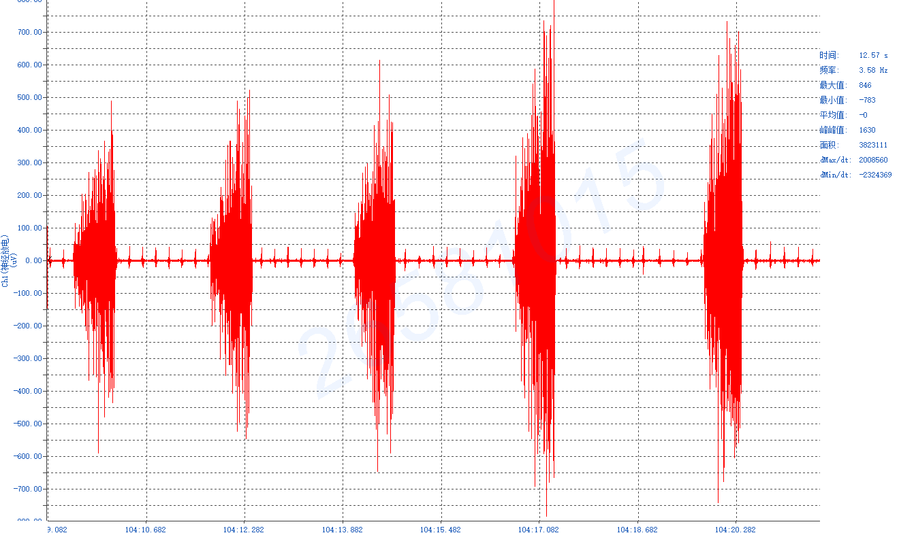{width=85%}

图2 吸入氮气时的原始放电曲线

放电簇幅度明显增大，峰峰值1630
µV；图示放电簇间隔较初始记录延长，不能据此写为呼吸频率一定增加。

## 吸入二氧化碳与肺充气
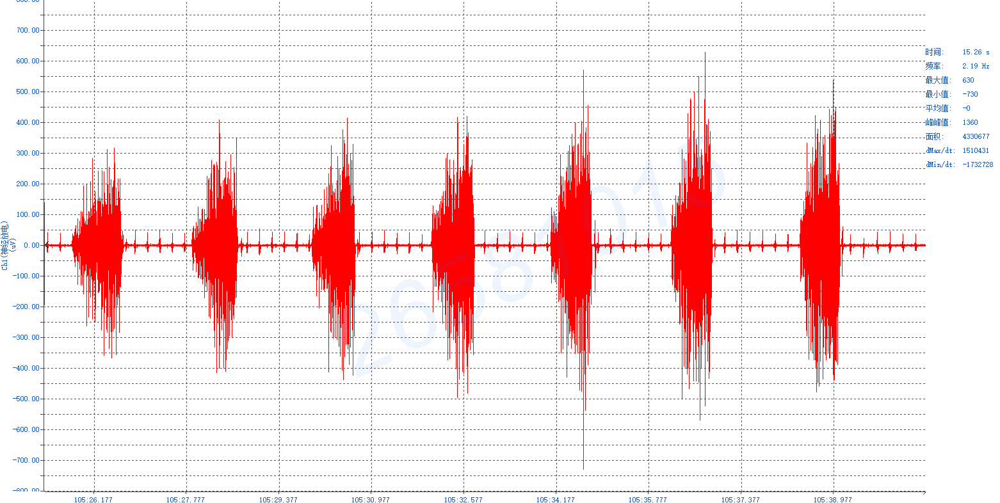{width=85%}

图3 吸入二氧化碳时的原始放电曲线

放电簇仍呈周期性出现，幅度较初始记录增大，峰峰值1360
µV。该截图中簇间隔亦较长，幅度与节律变化应分别描述。

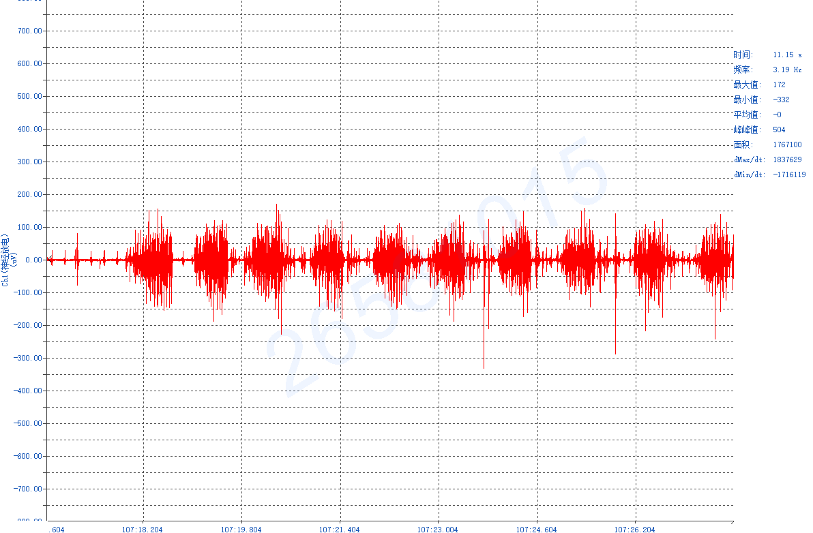{width=85%}

图4 打气时的原始放电曲线

放电簇幅度较气体处理记录小，峰峰值504
µV，簇间仍有放电活动。截图不足以确定注气瞬间是否发生及持续多久的呼吸暂停。

## 抽气与生理盐水
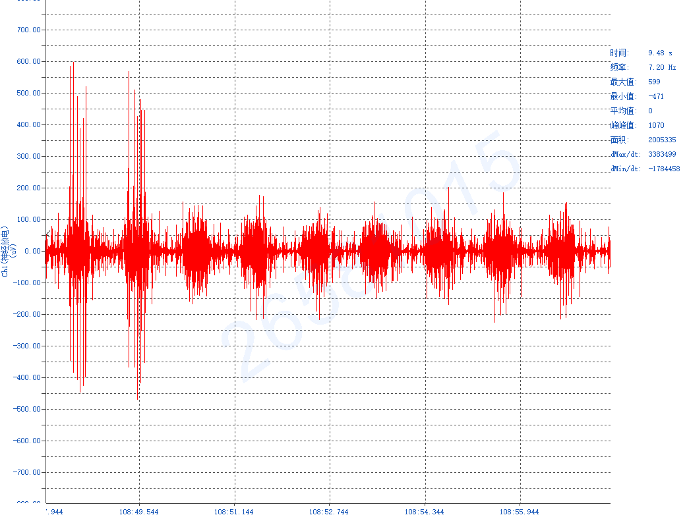{width=85%}

图5 抽气时的原始放电曲线

前段出现较高尖峰，随后可见连续簇状放电，峰峰值1070
µV。前端尖峰可能混有操作伪差，应与稳定放电簇区别观察。

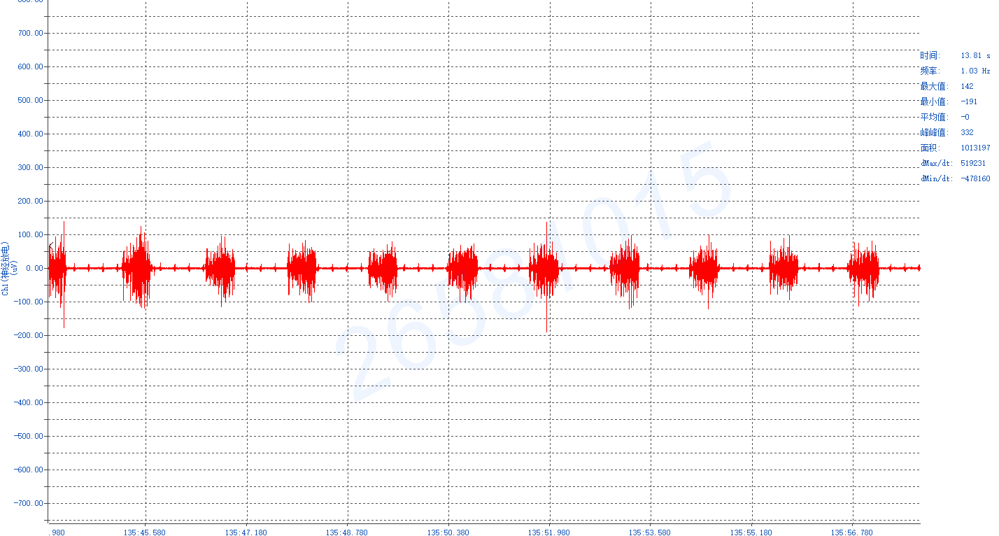{width=85%}

图6 生理盐水时的原始放电曲线

簇状放电较规则、幅度较小，峰峰值332 µV，可作为药物观察阶段的参照记录。

## 乳酸与尼可刹米
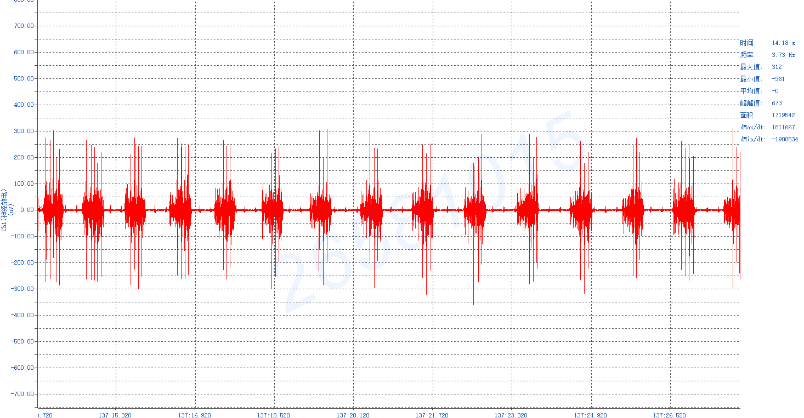{width=85%}

图7 乳酸时的原始放电曲线

放电簇较生理盐水时段密集，峰峰值673
µV，提示该时段吸气相关电活动较参照记录增强。

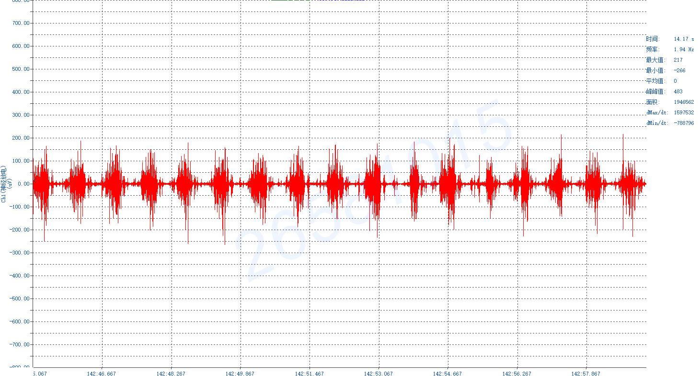{width=85%}

图8 尼可刹米时的原始放电曲线

保持较密集的簇状活动，峰峰值483
µV，高于生理盐水时段，但低于乳酸时段；不能仅凭两张截图判定药物效力的大小。

## 迷走神经切断前与单侧切断
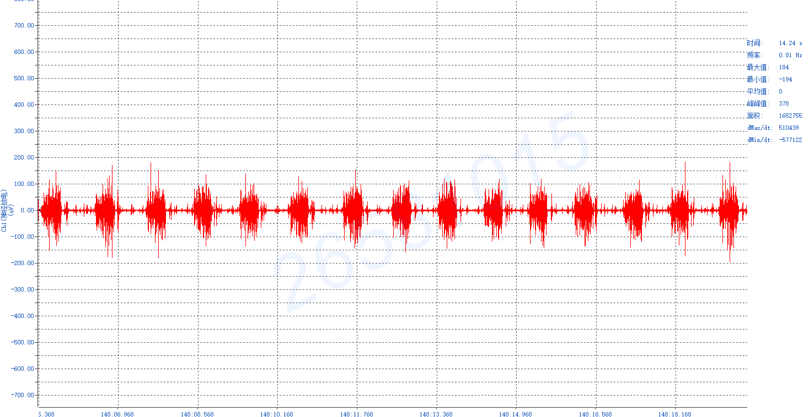{width=85%}

图9 剪断迷走神经前时的原始放电曲线

簇状活动较规则，峰峰值378 µV，为迷走神经处理阶段的参照记录。

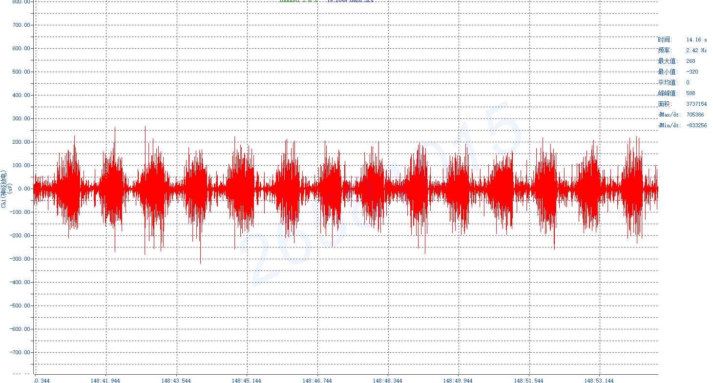{width=85%}

图10 剪断单侧迷走神经时的原始放电曲线

放电簇幅度较切断前增大，峰峰值588
µV，簇间低幅活动有所增加，仍保留较规则的节律。

## 双侧迷走记录与重复抽吸
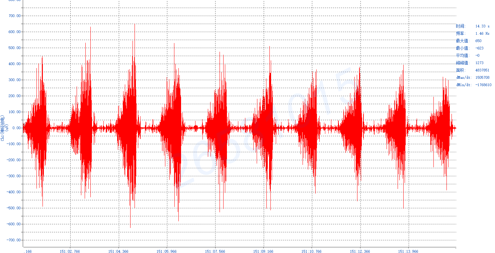{width=85%}

图11 双侧迷走神经记录时的原始放电曲线

相较切断前，簇状放电幅度明显增大，峰峰值1273
µV，放电簇间隔延长，呈现电活动增强而节律变慢的特点。

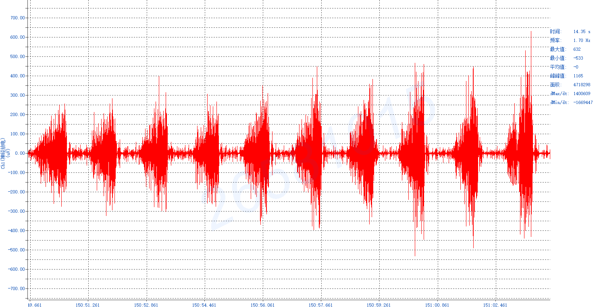{width=85%}

图12 重复抽吸时的原始放电曲线

可见较大的簇状活动，峰峰值1165
µV。该图与双侧迷走图的横轴时间先后不同，不能单凭资料排列顺序认定其发生于双侧切断之后。

# 实验讨论
## 吸入氮气与二氧化碳的影响
教材指出，动脉血氧分压降低、二氧化碳分压升高及pH下降均可通过化学感受性反射影响呼吸活动[1]。吸入氮气主要通过降低吸入氧分压形成低氧刺激；吸入二氧化碳则增加二氧化碳负荷。二者改变呼吸驱动的途径不同，其效应还取决于气体浓度、作用时间和动物当时状态。

本次氮气、二氧化碳时段的峰峰值分别为1630、1360 µV，均高于初始记录的605
µV，表现为放电幅度增大；但截图中的簇间隔并未较初始记录一致缩短。因此，结果支持气体条件变化伴随吸气相关电活动改变，尚不足以直接得出"两种气体均使呼吸加快"或比较两者刺激强弱的结论。较重低氧对中枢的抑制、刺激阶段不同以及基线不一致均是可能解释，不能由现有截图逐一证实。

## 肺充气和抽气与肺牵张反射
肺扩张可兴奋肺牵张感受器，其传入纤维经迷走神经进入中枢，促使吸气终止并向呼气转换；肺萎陷则可通过反射兴奋吸气[1]。因此，充气、抽气的方向和时机都会影响观察结果。

打气时段幅度较小，与吸气活动受到抑制的预期方向相符；抽气时段则出现较大的放电范围。不过，原图没有连续标明刺激开始、维持与解除的全过程，不能确定反射潜伏期、暂停时长及完整恢复过程。抽气前段的尖峰还可能含有机械扰动，不能全部归为生理性增强。

## 乳酸和尼可刹米的影响
乳酸可使血液酸度增加，按教材原理可通过化学感受性反射促进呼吸；尼可刹米属于呼吸兴奋药，其影响应结合处理前后吸气活动判断[1]。本次乳酸与尼可刹米时段放电簇均较生理盐水时段密集，峰峰值分别为673、483
µV，较生理盐水时段的332 µV增大，与呼吸相关电活动增强的解释相容。

不同药物时段的峰峰值并非等剂量、等时间的药效指标。缺少给药前后连续稳定基线和实际剂量记录时，不能据此认定乳酸的"效力"大于尼可刹米。现有曲线也不包含吗啡抑制与解救的完整配对过程，不能据此评价尼可刹米逆转吗啡抑制的效果。

## 迷走神经在呼吸调节中的作用
切断前、单侧切断及双侧迷走记录的峰峰值依次为378、588、1273
µV。双侧记录的放电簇幅度更大、簇间隔更长，与迷走神经肺牵张反射传入减少后吸气活动延长、呼吸节律变慢的预期方向一致[1]。单侧切断后对侧传入仍可能保留，故其变化不必与双侧切断完全相同。

电信号幅度增大不能直接证明潮气量增加；"深慢呼吸"的生理解释仍需结合积分曲线、呼吸相时程或通气量记录。重复抽吸图的横轴约在150:49之后，双侧迷走图则约在151:01之后，资料中的排列与图示时间并不完全一致，故本次不把重复抽吸图作为双侧切断后肺牵张反射消失的确定证据。

## 记录局限与实验改进
首先，初始图内可见"AIR IN 20
ml"标记，说明起始对照可能受机械操作影响；跨时段比较应优先采用每项处理前的稳定基线。其次，膈肌电幅度受电极固定、肌肉接触、放大增益、动物动作及基线噪声影响，需保持记录条件一致，并区分呼吸簇与操作伪差。

再次，本次截图未同步展示完整积分曲线、血气与pH、实际给药量、气流速度及刺激持续时间，因而只能进行描述性分析。改进时应保存连续原始信号，标明每次给药、注气、抽气和神经切断的准确时刻；固定时间窗计数放电簇，并结合积分面积及呼吸相时程分析。动物数量和独立重复信息不足时，不作总体疗效或统计显著性的推断。

# 实验结论
（1）吸入氮气与二氧化碳时段均见放电幅度较初始记录增大，但节律变化需单独判断，本次不能简单归纳为均使呼吸加快。

（2）肺充气和抽气时的曲线存在差异，与肺牵张反射调节吸气活动的原理相容；完整反射时程仍需连续记录验证。

（3）乳酸、尼可刹米时段较生理盐水时段呈现更密集的放电簇和较大的峰峰值，提示呼吸相关电活动受到影响。

（4）双侧迷走记录呈现较切断前更大的放电簇和更长的簇间隔，支持迷走神经参与呼吸节律调节；现有资料不足以确认重复抽吸发生在双侧切断之后。

# 参考文献 {-}

[1]《功能学科实验教程》. 第三节 呼吸系统实验，实验3.1
呼吸调节及药物影响：124--127.

[2]本组实验原始记录.
原始数据文件：初始、气体刺激、肺充气与抽气、药物及迷走神经处理共12幅记录图，2026年10月15日.
