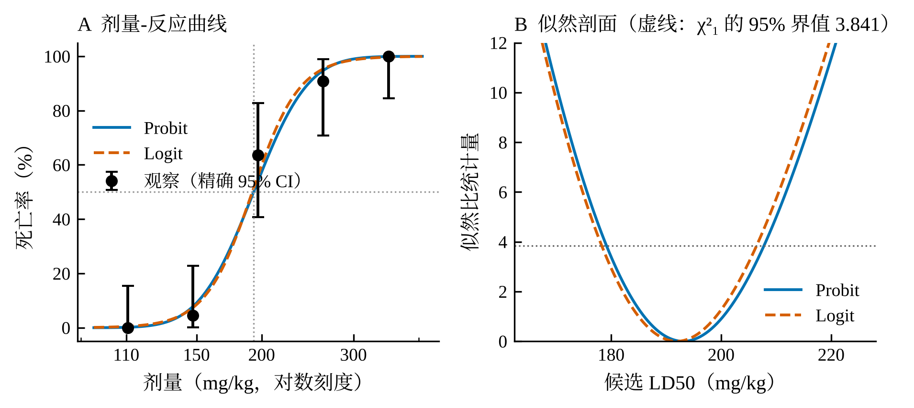
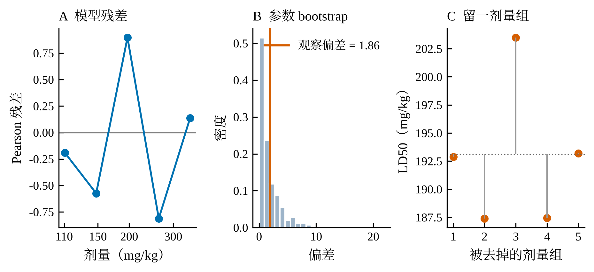
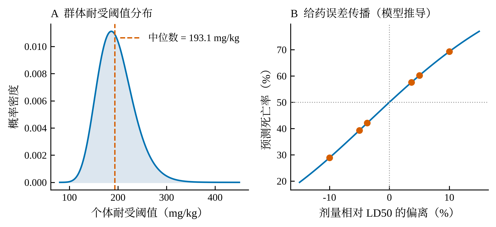

> **示例说明**　这是演示用示例：数字取自作者班级的汇总结果，**文字由工具流程重新撰写**，姓名学号等已隐去。重点不在数据本身，而在流程能做什么：教材方法复现、模型比较、拟合优度、稳健性检验、局部敏感性、规范作图、可复现命令（见附录）。请勿抄袭，请用你自己的实验记录。

# 摘要 {-}

测定盐酸普鲁卡因经小鼠腹腔注射的半数致死量（LD50）。全班汇总 110 只小鼠，分 5 个剂量组（110.8～350.0 mg/kg），每组 22 只，观察 2 h 内死亡数，死亡率由 0/22 递增至 22/22。改良寇氏法求得 LD50 为 191.85 mg/kg（95% 可信限 178.25～206.48 mg/kg）；以 Probit 与 Logit 模型作最大似然拟合，LD50 分别为 193.10 与 191.92 mg/kg，三种估计相差不超过 1.3 mg/kg，可信区间高度重叠。拟合优度检验未提示模型不适合（偏差 1.859，P = 0.602），留一剂量组分析显示 LD50 在 187.4～203.5 mg/kg 之间变动，以 196.9 mg/kg 组影响最大。结果支持以约 192 mg/kg 作为本批数据的 LD50 估计值。

**关键词：**半数致死量；质反应；改良寇氏法；Probit 模型；盐酸普鲁卡因

# 引言

按效应的性质，药物作用分为量反应与质反应：前者的指标可以连续测量，后者只有“发生”与“不发生”两种结局，如存活或死亡[1]。质反应实验把动物分组，各组给予不同剂量，统计各组出现反应的动物百分率；在一定范围内，反应率随剂量增大而递增，剂量取对数后曲线呈对称的“S”形，反应率转换为概率单位后与对数剂量呈直线关系，死亡率 50% 所对应的剂量即半数致死量[1]。

LD50 是评价药物急性毒性的基本指标，并与半数有效量（ED50）一起用于计算治疗指数以评价安全性[1]。LD50 的算法不止一种，其中 Bliss 法（概率单位正规法）最严谨，教材着重介绍较为简便的改良寇氏法[1]。本实验用盐酸普鲁卡因腹腔注射测定小鼠 LD50，并在教材方法之外，用二项模型的最大似然拟合对结果作交叉验证，检查结论是否依赖于所选方法和某个剂量组。

# 材料与方法

## 实验对象与药品

小鼠，体重约 20 g，全班汇总 110 只，随机分为 5 组，每组 22 只。盐酸普鲁卡因溶液浓度分别为 1.108%、1.477%、1.969%、2.625% 和 3.5%，对应剂量 110.8、147.7、196.9、262.5 和 350.0 mg/kg；动物以 5% 苦味酸标记；器材为天平、1 mL 注射器和鼠笼[1]。

## 实验步骤

小鼠称重后按体重给药，容积为 0.1 mL/10 g（即 10 mL/kg），各组腹腔注射相应浓度的盐酸普鲁卡因溶液，注意准确称重、准确抽取药液、避免腹腔给药时漏液[1]。给药后 2 h 内记录各组的中毒表现和死亡数，最后合并全班数据计算 LD50。

## 观察指标与数据处理

观察指标为 2 h 内各组死亡数及死亡率（p，以小数表示）。数据处理分四步，均由脚本完成以保证可复现：

（1）**改良寇氏法**：设最大剂量对数值为 $\lg D_{max}$，相邻两组剂量比值的对数为 $I$，则

$$\lg \mathrm{LD}_{50} = \lg D_{max} - I\left(\sum p - 0.5\right)$$

其标准误为 $s = I\sqrt{\sum p(1-p)/(n-1)}$，95% 可信限为 $10^{\lg \mathrm{LD}_{50} \pm 1.96s}$[1]。该法要求最小剂量组死亡率为 0、最大剂量组为 100%，本数据满足。

（2）**二项模型**：令 $x=\ln(D/200)$，各组死亡数服从二项分布，$\Phi^{-1}(\pi)=a+bx$（Probit）或 $\mathrm{logit}(\pi)=a+bx$（Logit），以最大似然估计 $a$、$b$，$\mathrm{LD}_{50}=200\,e^{-a/b}$；其 95% 可信区间取似然剖面中似然比统计量不超过 3.841 的范围。

（3）**拟合优度**：计算偏差及 Pearson 残差，并以拟合的 Probit 模型为真模型做 3 000 次参数 bootstrap，求观察偏差在其分布中的位置；两个模型用 AIC 比较。

（4）**稳健性**：逐一去掉一个剂量组后重新估计 LD50（留一剂量组）。

死亡率的 95% 可信区间采用 Clopper–Pearson 精确法。作图采用对数剂量轴，误差线含义写入图注。

# 结果

## 各剂量组死亡率

以剂量的对数为横轴，死亡率随剂量增大由 0/22 单调递增至 22/22（表 1），呈长尾“S”形曲线的上升段。最小剂量组无死亡，最大剂量组全部死亡，满足改良寇氏法的适用条件。死亡率变化集中在 147.7～262.5 mg/kg 之间，仅 196.9 mg/kg 一组（14/22）接近 50%。

**表 1　各剂量组的小鼠死亡情况**

| 组别 | 剂量（mg/kg） | 动物数 | 死亡数 | 死亡率（%） | 死亡率 95% 可信区间（%） |
|:-:|:-:|:-:|:-:|:-:|:-:|
| 1 | 110.8 | 22 | 0 | 0.0 | 0.0～15.4 |
| 2 | 147.7 | 22 | 1 | 4.5 | 0.1～22.8 |
| 3 | 196.9 | 22 | 14 | 63.6 | 40.7～82.8 |
| 4 | 262.5 | 22 | 20 | 90.9 | 70.8～98.9 |
| 5 | 350.0 | 22 | 22 | 100.0 | 84.6～100.0 |

注：可信区间为 Clopper–Pearson 精确区间。

## LD50 的三种估计

改良寇氏法得 $I=0.124882$，$\sum p=2.590909$，$\lg\mathrm{LD}_{50}=2.282951$，$s=0.016293$，LD50 = 191.85 mg/kg，95% 可信限为 178.25～206.48 mg/kg。Probit 模型拟合得 $a=0.18558$、$b=5.28410$，LD50 = 193.10 mg/kg；Logit 模型的估计为 191.92 mg/kg（表 2）。三种估计两两相差不超过 1.3 mg/kg（0.7%），各自的 95% 可信区间几乎重合。图 1A 显示两条拟合曲线几乎重叠，且均穿过各组观察死亡率的精确区间；图 1B 的似然剖面在 3.841 处截得的区间与表 2 一致。

**表 2　三种方法的 LD50 估计**

| 方法 | LD50（mg/kg） | 95% 可信区间（mg/kg） | AIC | 偏差（df = 3） | 拟合优度 P |
|:--|:-:|:-:|:-:|:-:|:-:|
| 改良寇氏法 | 191.85 | 178.25～206.48 | – | – | – |
| Probit | 193.10 | 179.16～207.79 | 13.823 | 1.859 | 0.602 |
| Logit | 191.92 | 178.29～206.44 | 13.901 | 1.938 | 0.585 |

{width=100%}

## 剂量–死亡曲线的陡度

由 Probit 模型得到 LD10 = 151.51 mg/kg，LD90 = 246.10 mg/kg，LD90/LD10 = 1.62，即死亡率由 10% 升至 90% 只需剂量增加约 62%，曲线较陡。主要 LDq 见表 3。

**表 3　Probit 模型的 LDq 估计**

| 指标 | 估计（mg/kg） | 95% 可信区间（mg/kg） |
|:-:|:-:|:-:|
| LD05 | 141.45 | 120.70～158.46 |
| LD10 | 151.51 | 132.51～167.22 |
| LD25 | 169.96 | 154.03～183.91 |
| LD50 | 193.10 | 179.16～207.79 |
| LD75 | 219.39 | 203.29～240.97 |
| LD90 | 246.10 | 224.20～279.80 |
| LD95 | 263.61 | 236.82～307.08 |

## 拟合优度与稳健性

Probit 模型的偏差为 1.859（df = 3，P = 0.602），Pearson 残差在 −0.81～0.90 之间（图 2A）；参数 bootstrap 3 000 次，观察偏差落在其分布的中部（P = 0.311，图 2B）。留一剂量组分析中，去掉第 1、5 组对 LD50 几乎无影响（192.88、193.18 mg/kg），去掉第 2、4 组使估计降至约 187.4 mg/kg，去掉第 3 组（196.9 mg/kg）使估计升至 203.50 mg/kg，变化 10.40 mg/kg，为影响最大的一组（图 2C）。

{width=100%}

## 局部剂量敏感性与给药误差

Probit 模型意味着个体耐受阈值服从对数正态分布：$\ln(T/200)\sim N(\mu,\sigma^2)$，$\mu=-a/b=-0.03512$，$\sigma=1/b=0.18925$，几何标准差 $e^{\sigma}=1.208$（图 3A）。在 LD50 处，死亡概率对对数剂量的斜率为

$$\left.\frac{d\pi}{d\ln D}\right|_{\mathrm{LD}_{50}}=\frac{b}{\sqrt{2\pi}}=2.108$$

即剂量增加 1%，死亡概率约增加 2.1 个百分点；剂量偏离 LD50 ±10% 时，模型预测死亡率为 28.9% 或 69.3%（图 3B）。以 27 g 小鼠按 10 mL/kg 给药为例，应给 0.27 mL，0.01 mL 的抽取误差相当于 3.70% 的剂量误差，对应死亡率为 42.1%～57.6%。因此在 LD50 附近，给药体积的细小误差就足以使单组死亡率明显偏离 50%。

{width=100%}

# 讨论

**三种方法结论一致。** 教材的改良寇氏法与两个二项模型给出的 LD50 相差不到 1%，且可信区间重叠，说明本批数据的 LD50 估计并不依赖于方法选择。Probit 与 Logit 的 AIC 仅差 0.078，没有证据表明其中一个明显更好；教材指出 Bliss 法（概率单位正规法）最为严谨[1]，本实验的 Probit 拟合在思路上与之相近，但未采用权重迭代和概率单位表，细节不尽相同。

**拟合未见明显偏离，但检验力有限。** 偏差检验和 bootstrap 均未提示模型不适合；但仅有 5 个剂量组，其中只有 3 组处于 0 与 100% 之间，模型的斜率主要由这三组决定，故“未见偏离”不等于“模型一定正确”。留一分析显示 196.9 mg/kg 组（14/22）对估计影响最大，这是合理的：该组最靠近 50%，信息量最大；而若该组的死亡数因个体差异或给药误差偏离，LD50 估计可相应移动约 10 mg/kg。

**给药精度决定了结果的可靠程度。** 局部敏感性分析显示，LD50 附近剂量每变化 1%，死亡率变化约 2.1 个百分点，0.01 mL 的体积误差就可使单组死亡率偏离 50% 约 7 个百分点，因此称重、抽药与注射的准确（教材注意事项）并非形式要求[1]。

**可信区间的含义与局限。** 上述区间假定各动物独立、各组死亡数服从二项分布；全班汇总意味着不同操作者、不同鼠批次和不同给药细节被混在一起，组内可能存在比二项分布更大的变异（过度离散）。本数据 bootstrap 检验未提示这一问题，但这并不能排除。另外，剂量按体重折算，用固定容积（0.1 mL/10 g）时给药体积的小误差会直接转化为剂量误差；腹腔注射漏液同样会使实际剂量偏低[1]。

**与急性毒性分阶段方法的关系。** 本实验每个剂量用 22 只动物，目的在于得到较精确的 LD50 与可信限；若仅需估计急性毒性的范围，可采用动物数更少的分阶段方法[2]，与教材方法对照阅读有助于理解不同目的下的动物数选择。

**与治疗指数的衔接。** LD50 本身只反映急性毒性，评价药物安全性还需与 ED50 比较（治疗指数 = LD50/ED50）；当有效与致死的量–效曲线不平行时，治疗指数不能准确反映两端的差距，应改用安全范围（LD5/ED95）评价[1]。本实验的曲线陡度（LD90/LD10 = 1.62）可作为后者的输入之一。

# 结论 {-}

（1）盐酸普鲁卡因小鼠腹腔注射的 LD50 为 191.85 mg/kg（改良寇氏法，95% 可信限 178.25～206.48 mg/kg）；Probit 与 Logit 模型分别为 193.10 与 191.92 mg/kg，三者一致，约 192 mg/kg。

（2）拟合优度检验未提示模型不适合；LD50 对剂量组的取舍较敏感，以 196.9 mg/kg 组影响最大（最大变化 10.4 mg/kg），结论应结合可信区间解释。

# 参考文献 {-}

[1] 严钰锋，马淑兰. 功能学科实验教程[M]. 2020: 173-175.

[2] LORKE D. A new approach to practical acute toxicity testing[J]. Archives of Toxicology, 1983, 54(4): 275-287. DOI: 10.1007/BF01234480.

# 附录　可复现命令 {-}

本报告中的计算、统计与作图全部由下列命令生成（均在仓库根目录运行）：

```
python tools/rag.py search 半数致死量 改良寇氏法 --exp 8.1 -c expr          # 课本术语与句式
python tools/rag.py search 急性毒性 LD50 -c literature                       # 文献
python tools/labcalc.py ld50 --doses 110.8 147.7 196.9 262.5 350 --n 22 --deaths 0 1 14 20 22
python tools/labdose.py --dose 110.8 147.7 196.9 262.5 350 --n 22 --deaths 0 1 14 20 22 \
       --ref 200 --dev 3.7 5 10 --figs examples/sample-report/figures
python tools/stylecheck.py examples/sample-report/report.md --exp 8.1        # 语言检查
python tools/refcheck.py examples/sample-report/report.md --offline          # 文献核对
python tools/build.py examples/sample-report/report.md --to all               # 出稿
```
